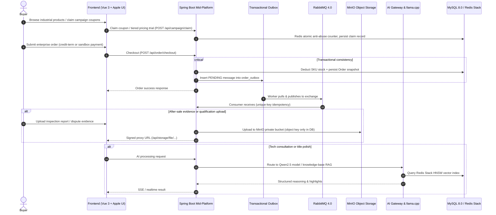

<div align="center">

# LANLinkshopping

### Aggregated Diversified Solutions · Modern Industrial-Grade B2B E-Commerce Full-Stack Platform

**Spring Boot 3.5.3 + Vue 3 (Vite 6) + Redis Stack HNSW + MinIO S3 + RabbitMQ 4.0 + Local Dual-LLM Orchestration + Dify Workflows + Apple UI Interaction Standards**


[](https://x.com/Orion_Yves_Jude)
[](https://www.facebook.com/profile.php?id=61590596057471)

[Features](#-features--business-matrix) · [Architecture](#-system-architecture--technology-landscape) · [Developer Guide](#-developer-handbook--debugging-guide) · [Quick Start](#-quick-start--environment-setup) · [Core APIs](#-core-api-overview) · [Twitter (X)](https://x.com/Orion_Yves_Jude) · [Facebook](https://www.facebook.com/profile.php?id=61590596057471) · [Contact & Declaration](#-contact--originality-declaration) · [License](#-license)

**English** · [简体中文](./README.md)

</div>

---

## 📖 Project Overview & Positioning

**LANLinkshopping** is an **aggregated, multi-industry, B2B integrated full-stack e-commerce mid-platform** designed for modern industrial supply chains, bulk production-material group procurement, enterprise collaboration, and technology-transfer commercialization. It deeply covers the five core transaction loops of **unified identity & access control · merchant self-service onboarding with qualification review · 24-industry product mall · intelligent collaborative recommendation · shopping cart · order payment & reconciliation fulfillment**, and has evolved major industrial mid-platform capabilities including: **industrial technology-service trading center, logistics GIS trajectory & trunk dispatch hub, enterprise periodic subscription procurement, enterprise credit-term calculator, after-sale multi-media evidence chain, campaign venue & coupon center, AI-powered product title polish, live commerce, Apple-morphic fluid interaction system, local dual-LLM orchestration (Qwen2.5-7B + Qwen2.5-VL), MinIO object storage & RabbitMQ transactional messaging, SQLBot intelligent data-query integration (LLM + RAG Text-to-SQL)**.

### 🌟 Core Delivery Forms

1. **Web E-Commerce Full-Stack Mainline**: High-performance adaptive platform built on Spring Boot 3.5.3 + MyBatis-Plus + Vue 3 (Vite 6 + Pinia + Ant Design Vue + Lucide pure-vector icons).
2. **Industrial Technology-Service & Tech-Transfer Mid-Platform**: Industrial demand publishing & bounty challenges, achievement appraisal, technology-contract milestone management with third-party escrow, expert consultation, pilot-testing reservations, and full-lifecycle equipment hosting & maintenance.
3. **Logistics GIS Trajectory & Trunk Hub**: WGS84/GCJ02/BD09 bidirectional precision coordinate conversion, China trunk-logistics topology distance computation, transit-node timeline inference, dwell-timeout & waybill anomaly red/yellow-light alert dispatch.
4. **Enterprise Credit-Term Precision Calculator**: Enterprise credit-rating model, tiered credit-line simulation, T+30/T+60/T+90 billing with dynamic overdue-interest computation.
5. **After-Sale Negotiation & Multi-Media Evidence Chain**: Refund/return/exchange/on-site repair multi-track flows, buyer/seller/platform three-way arbitration history, MinIO S3 private-bucket signed-proxy secure evidence storage.
6. **Campaign Venue & Coupon Center**: High-concurrency claim anti-abuse, tiered spend-threshold coupon packs, real-time coupon trial calculation at checkout with intelligent recommendation.
7. **Live Commerce**: Enterprise broadcasting, shop-while-streaming product shelves, real-time danmaku streaming and viewer engagement heat statistics.
8. **Apple UI Interaction Standards & Next-Gen Component Library**: macOS-morphic fluid Dock, iPhone Dynamic Island capsule, 3D depth card carousel, FluidTabs, GlowBorderCard, RadarPulseBadge, and silky mobile drawer.
9. **Enterprise AI Hub & Multi-Agent System**: Docker-hosted llama.cpp with dual-model hot-swap Router (Qwen2.5-7B text + Qwen2.5-VL vision), hardware-VRAM-aware scheduler, Redis Stack HNSW vector knowledge base (bge-m3 1024-dim embeddings), Dify multi-agent workflows, and standard MCP (Model Context Protocol) vector-search tooling (`lanlink_kb_search`).
10. **High-Reliability Transactional Middleware**: MinIO-based S3-compatible object-storage adapter (backend read-only private-bucket proxy); RabbitMQ 4.0 Transactional Outbox pattern with unique MessageID consumer dedup and dead-letter queue (`q.notify.dlq`) compensation.
11. **Local LLM Fine-Tuning & Post-Training** (`training/`): Unsloth/TRL-based Qwen2.5-7B LoRA/SFT intent fine-tuning, AGL/GRPO reinforcement-learning loop, frozen-set baseline evaluation, and GGUF quantized export.
12. **Full-Chain Observability & Resilience** (`monitoring/` & `scripts/`): Prometheus metrics, Grafana dashboards, chaos fault-injection testing, daemon health watchdog, and high-concurrency stress benchmarks.
13. **Legal Compliance Hub & Bidirectional Penalty System**: 8 bilingual legal agreements including the User Service Agreement, Merchant Onboarding & Operation Compliance Code, and Buyer Trading Rules; merchant paid-in capital ≥ ¥100,000 hard threshold; annual 12-point dynamic scoring, tiered disposal, and honest-buyer protection.
14. **Merchant Exit & Closure Lifecycle Governance**: "Apply → Ops review → 30-day statutory public notice (withdrawable) → Freeze & liquidation → Formal closure" five-state irreversible soft-close loop with six exit gates, write-operation freeze, deposit ledger, and merchant/ops dual-end audit trails, adhering to the second-clearing compliance boundary (deposit ledger-only, no real fund transfers).
15. **Merchant Fund Withdrawal & Finance Module** (`merchant-finance`, 2026-11): Full withdrawal state machine (pending → paid / rejected / withdrawn) with conditional-update CAS, append-only finance ledger with per-row `balance_after` snapshots, merchant-row exclusive lock anti-double-spend (validated by real concurrent regression tests), bank account stored masked (first-4/last-4 only), and field-level JWE encryption (RSA-2048 + A256GCM).
16. **Order Review Closed Loop** (independent order-dimension model, 2026-11): Dedicated `t_order_review` table (per-order-item rows, unique key preventing duplicate reviews), same-transaction rating aggregation to `t_product_rating_stat`, buyer/merchant dual-end UI, and SearchRankScorer regression-green decoupling.
17. **SEO Baseline & Per-Route TDK Injection** (CSR, 2026-11): `robots.txt` / `sitemap.xml` static assets, per-route meta injection (34 public routes) with private-route fallback to global defaults, product-detail dynamic real-name injection, and alert-delivery dual-channel (email fallback + IM webhook via adapters; real addresses root-`.env`-only, never committed).

### 18. SQLBot Intelligent Data-Query Integration (LLM + RAG Text-to-SQL, 2026-11)

Integration of [dataease/SQLBot](https://github.com/dataease/SQLBot) as the platform's conversational data-analysis engine: ask questions in natural language, get generated SQL and executed results (powered by LLM + RAG).

- **Deployment form**: `dataease/sqlbot:latest` container (independent compose project `shopping-sqlbot`, orchestration in [`docker-compose.sqlbot.yml`](docker-compose.sqlbot.yml)), UI at `127.0.0.1:8000`, built-in MCP service at `8001` (SSE transport, 7 tools).
- **Local patches** ([`sqlbot-patches/`](sqlbot-patches/), read-only mounts): super-admin check relaxed from "id + account dual condition" to "id==1 only" (`user.py`/`mcp.py`); **re-verify patch applicability against original files after image upgrades**.
- **LLM wiring**: SQLBot admin-side model points to [`lanlink-ai-gateway`](ai-gateway/) (OpenAI-compatible, `qwen2.5-7b`); the model's advanced-parameter `config_list` must be `extra_body: {"use_kb": false}` (JSON-string form) — disables gateway-side RAG template rewriting to protect Text-to-SQL prompts.
- **Data source**: `shopping-mysql-1`'s `lanlink_shopping` database via dedicated read-only account `sqlbot_ro` (SELECT on business tables only); table metadata synced via `chooseTables` (6 core business tables, 144 fields).
- **External models via MCP**: gateway registers the `lanlink_ask_data` tool ([`ai-gateway/app/sqlbot_tools.py`](ai-gateway/app/sqlbot_tools.py), `access_token → mcp_start → mcp_question` chain); external AI models query platform business data conversationally via `/v1/chat/completions` (tools=auto).
- **Stability hardening**: gateway semantic-cache write gate disabled for sql_gen-class requests (`main.py` Step 4) — same-question retries no longer hit cached refusal texts; 10/10 consecutive acceptance (5 direct + 5 MCP-chain).

---

## 🏛️ System Architecture & Technology Landscape

### 1. Overall Architecture Topology

```mermaid
flowchart TD
    subgraph Client["Presentation Layer"]
        WebDesktop["Desktop Web (Vue 3 + Vite 6 + Ant Design Vue)"]
        WebMobile["Mobile H5 Browser (adaptive low-saturation theme)"]
        AppleUI["Apple-morphic Fluid Interaction (Dock / Dynamic Island / FluidTabs / GlowCard / 3D Carousel)"]
    end

    subgraph Gateway["Gateway & Network Ingress"]
        NginxIngress["Nginx static acceleration & reverse proxy (Port: 5173 / 5174)"]
        SpringCloudGW["Spring Boot API gateway pre-filters (Context: /api)"]
        SecGuard["Security line (CSRF double-submit / TOTP 2FA / tiered rate-limit / AES-256-GCM / brute-force lockout)"]
    end

    subgraph BizHub["Core Business & Mid-Platform Layer"]
        AuthSvc["Unified Auth Hub (RBAC 5-level / Google & Apple OAuth)"]
        MerchantSvc["Merchant Mid-Platform (onboarding review / storefront / self-publishing)"]
        ProductSvc["Product & Category Hub (24 industries / multi-spec SKU / tiered wholesale pricing)"]
        TechSvc["Industrial Tech-Service Mid-Platform (contracts / milestones / escrow / experts / pilot)"]
        GisLogisticsSvc["Logistics GIS Dispatch Hub (WGS84-GCJ02-BD09 / trunk routing / anomaly alerting)"]
        OrderPaySvc["Trading & Payment Hub (atomic stock / sandbox checkout / credit terms)"]
        CampaignSvc["Campaign & Coupon Center (venue / tiered coupons / batch claim anti-abuse)"]
        SubscriptionSvc["Enterprise Periodic Subscription Procurement"]
        RefundDisputeSvc["After-Sale Negotiation & Evidence Chain"]
        LiveSvc["Live Commerce Hub (streaming hall / shoppable shelf / danmaku)"]
        RiskSvc["Real-time Risk Control & Audit"]
        AbSvc["A/B Testing Experiment Platform"]
        LegalComplianceSvc["Legal Compliance & Penalty Hub"]
        MerchantExitSvc["Merchant Exit & Closure Governance"]
        FinanceSvc["Merchant Finance (withdrawal state machine / append-only ledger / anti-double-spend)"]
        ReviewSvc["Order Review Closed Loop (aggregation / anti-duplicate)"]
    end

    subgraph MidLayer["Transactional Middleware & Async Pipeline"]
        OutboxWorkers["Transactional Outbox Workers (OrderOutbox & NotifyOutbox)"]
        RabbitMQCluster["RabbitMQ 4.0 (Topic exchanges / consumer dedup / q.notify.dlq)"]
        MinIOS3["MinIO S3 Object Storage (qualifications / repair docs / read-only proxy)"]
        MailpitSvc["Mailpit local email debug sandbox"]
    end

    subgraph AIHub["AI & Multi-Agent Hub"]
        AiGateway["FastAPI AI Gateway (/v1/chat/completions + Tool Calling)"]
        ModelRouter["llama.cpp Dual-Model Router (Qwen2.5-7B + Qwen2.5-VL hot-swap)"]
        HwScheduler["Hardware-Aware Scheduler (GPU VRAM adaptive + CPU offload)"]
        DifyWorkflow["Dify Multi-Agent Workflows"]
        McpBridge["MCP Tool Bridge (lanlink_kb_search / SQLBot ask-data)"]
        AiTitleEngine["AI Product Title Polish"]
        SupportRAG["Support RAG (local KB first + external fallback + PII masking)"]
        SqlBot["SQLBot Text-to-SQL (LLM + RAG, MCP-accessible)"]
        PostTrain["Local Fine-Tuning (LoRA / SFT / GRPO / GGUF)"]
    end

    subgraph DataHub["Data & Storage Layer"]
        MySQLStore["MySQL 8.0 (InnoDB row locks / strong consistency)"]
        RedisHNSW["Redis Stack 7.4 (HNSW index aikb-idx + cache + rate counters)"]
        EmbeddingEngine["bge-m3 local dense embedding (1024-dim)"]
    end

    subgraph Observability["Observability & Resilience"]
        PrometheusNode["Prometheus metrics (QPS / TPS / latency / VRAM)"]
        GrafanaDash["Grafana dashboards"]
        AdminMetricsView["Admin real-time metrics screen (AdminMetrics.vue)"]
        ChaosTest["Chaos drills & health watchdog"]
    end

    Client --> Gateway
    Gateway --> BizHub
    BizHub --> MidLayer
    MidLayer --> BizHub
    BizHub --> AIHub
    BizHub --> DataHub
    AIHub --> DataHub
    BizHub -.-> Observability
    MidLayer -.-> Observability
    AIHub -.-> Observability
```



### 2. Core Business Sequence (Condensed)



### 3. Technology Stack Summary

| Dimension | Technology | Version / Spec | Role |
|------|---------|-----------|----------------|
| **Backend** | Spring Boot | 3.5.3 (Java 17 LTS) | Core application container base |
| | MyBatis-Plus | 3.5.10.1+ | Persistence, pagination & SQL-injection-safe dynamic queries |
| | Spring Security | 6.x | RBAC 5-level auth, BCrypt salted hashing, TOTP 2FA |
| | Spring Cloud | 2025.1.x (skeleton) | Microservice pre-research (Nacos, Gateway, OpenFeign) |
| | Flyway | 11.7.2 | Versioned DB migration (baseline 2026.11.1) |
| **Frontend** | Vue.js | 3.5.x (Composition API) | Reactive SFC components |
| | Build tool | Vite 6.4.5 | ESM dev cold-start, HMR, Rollup production chunking |
| | UI library | Ant Design Vue 4.x | Enterprise-grade mid/back-office UI |
| | Icons | Lucide Vue Next | Site-wide pure-vector SVG governance, zero emoji |
| | State/routing | Pinia + Vue Router 4.x | Global reactive state, route guards |
| **Messaging & Storage** | Object storage | MinIO (S3-compatible) + AWS SDK v2 | Encrypted storage; private-bucket backend proxy |
| | Message queue | RabbitMQ 4.0 | Transactional Outbox, dedup, DLQ fallback |
| | Database | MySQL 8.0+ (InnoDB) | Row-level locks, ACID, indexed constraints |
| | Cache & vectors | Redis Stack 7.4 (RediSearch) | HNSW vector index, cache, rate-limit counters |
| **AI / LLM** | Inference base | llama.cpp (Docker + cuBLAS) | Local Qwen2.5-7B & Qwen2.5-VL (RTX 4070 Laptop 8G baseline; scale to 14B/32B/72B freely on larger hardware) |
| | OS | Ubuntu 22.04 / 24.04 LTS | Native Linux or WSL2 containers & fine-tuning |
| | GPU | CUDA 12.4 / 12.8 / 13.0 | cuBLAS & FlashAttention-2 acceleration |
| | AI Gateway | FastAPI + Uvicorn | OpenAI-compatible API, tool calling, streaming |
| | Embeddings | BAAI/bge-m3 | 1024-dim multilingual dense vectors |
| | Multi-agent | Dify DSL + MCP | Agent workflow orchestration; MCP read-only KB search (`lanlink_kb_search`) |
| | Text-to-SQL | SQLBot (dataease) | LLM + RAG conversational data analysis, MCP-accessible |
| | Fine-tuning | Unsloth + TRL + PyTorch | Industrial intent LoRA SFT, AGL/GRPO RL, GGUF export |
| **Ops & Observability** | Metrics | Prometheus + Grafana | QPS/TPS, P99 latency, GPU VRAM & temperature |
| | Resilience | Chaos / Watchdog | Fault drills, daemon health probing, self-healing |

---

## ✨ Core Business & Mid-Platform Capability Matrix

### 1. Basic Transaction Closed Loop (Five Core Modules)

| Module | Code Entry | Capabilities |
|------|-----------------|----------------|
| 🔐 **Auth Center** | [`UserController.java`](backend/src/main/java/com/lanlink/shopping/controller/UserController.java) | Phone registration/login, RBAC 5-level matrix (`GUEST`/`BUYER`/`VIP`/`MERCHANT`/`ADMIN`), TOTP 2FA, CSRF double-submit, brute-force lockout, social-login ready. |
| 🏪 **Merchant Onboarding** | [`MerchantCenterController.java`](backend/src/main/java/com/lanlink/shopping/controller/MerchantCenterController.java) | Online application (USCC validation, license MinIO storage), hard paid-in-capital threshold (≥ ¥100,000), compliance pre-screening, merchant back office. |
| 🛍️ **Multi-Industry Mall** | [`ProductController.java`](backend/src/main/java/com/lanlink/shopping/controller/ProductController.java) | 24-industry category index, tiered wholesale pricing, multi-spec SKUs, product review flow, price K-line dashboard. |
| 🛒 **Smart Cart** | [`Cart.vue`](frontend/src/views/Cart.vue) | Atomic spec-stock validation, bulk quantity edits, per-store selection, address-hub linkage & freight estimate. |
| 📦 **Order & Payment** | [`OrderController.java`](backend/src/main/java/com/lanlink/shopping/controller/OrderController.java) | Distributed/transactional atomic stock deduction, full order snapshots, Alipay/WeChat/wallet sandbox payments, points deduction (1000 pts = ¥1), credit-term deferred settlement. |

### 2–17. Mid-Platform Capabilities

The platform carries **17 additional mid-platform capability sections** covering: industrial technology-service trading (contracts/milestones/escrow/experts/pilot/appraisal/hosting), logistics GIS dispatch (coordinate conversion/trunk routing/anomaly alerting/settlement), campaign venue & coupon center, enterprise subscription procurement & task center, credit-term calculator & risk engine, after-sale evidence chain, AI title polish, Apple UI component library, local dual-LLM orchestration & MCP, bidirectional compliance & penalty system, merchant exit governance, concurrency-correctness hardening (2026-11, each with falsifiable regression tests), merchant finance/withdrawal, order review closed loop, SEO baseline & per-route TDK, and SQLBot Text-to-SQL integration. See the [Chinese README](./README.md#-核心业务与高阶微中台能力矩阵) for the full per-section detail with code entry points.

---

## 🛠️ Developer Handbook & Debugging Guide

### 1. Local Network Topology & Port Matrix

| Port | Service | Process/Container | Binding | Purpose |
|:---:|:---|:---|:---:|:---|
| **8080** | Spring Boot backend | `java.exe` | `127.0.0.1` | Core RESTful API, global context-path `/api` |
| **5173** | Frontend static / LAN acceptance | `nginx` (Docker) | `0.0.0.0` | Mobile real-device access `http://<LAN-IP>:5173` |
| **5174** | Frontend dev server | `Vite` | `127.0.0.1` | HMR dev port, proxies `/api` to backend 8080 |
| **3306** | MySQL 8.0 | `mysqld` / Docker | `127.0.0.1` | Business persistence DB, charset `utf8mb4_unicode_ci` |
| **6379** | Redis Stack 7.4 | `redis-stack-server` | `127.0.0.1` | RediSearch, `aikb-idx` HNSW vector index, cache |
| **9000** | MinIO S3 API | `minio` (Docker) | `127.0.0.1` | S3-compatible storage API |
| **9001** | MinIO Web console | `minio` (Docker) | `127.0.0.1` | Object storage management panel |
| **5672** | RabbitMQ AMQP | `rabbitmq` (Docker) | `127.0.0.1` | AMQP client connections |
| **15672** | RabbitMQ management | `rabbitmq` (Docker) | `127.0.0.1` | Queue monitoring, DLQ `q.notify.dlq` visibility |
| **8000** | SQLBot data-query UI + API | `sqlbot` (Docker) | `127.0.0.1` | Conversational data analysis (LLM + RAG Text-to-SQL) |
| **8001** | SQLBot MCP service | `sqlbot` (Docker) | `127.0.0.1` | SQLBot MCP (SSE) for external AI model access |
| **9093** | Alertmanager UI | `alertmanager` (Docker) | `127.0.0.1` | Alert console (silences/notifications; delivery via DingTalk/Feishu adapters) |
| **18123** | llama.cpp inference | `llama-cpp` (Docker) | `127.0.0.1` | Container 8123 → host 18123, GGUF dual-model inference |
| **1025** | Mailpit SMTP | `mailpit` (Docker) | `127.0.0.1` | Local test email delivery |
| **8081** | Mailpit Web inbox | `mailpit` (Docker) | `127.0.0.1` | Local mail inbox (container 8025), captures verification emails |
| **3000** | Batch Import Workflow | Node.js Worker | `127.0.0.1` | Bulk product & procurement import service |

> [!IMPORTANT]
> Except for the frontend port (bound to all NICs for LAN multi-device acceptance), databases, caches, object storage, message queues and AI services **bind strictly to `127.0.0.1` loopback only**, preventing LAN port probing and unauthorized penetration.

---

### 2. Environment Variables & Credentials (`.env`)

Follows the **12-Factor App** convention. Root `.env.example` documents all required keys:

```env
# 1. Core relational database (MySQL 8.0)
SPRING_DATASOURCE_URL=jdbc:mysql://localhost:3306/lanlink_shopping?...
SPRING_DATASOURCE_USERNAME=root
SPRING_DATASOURCE_PASSWORD=your_secure_mysql_password

# 2. Cache & vector store (Redis Stack HNSW)
SPRING_DATA_REDIS_HOST=localhost
SPRING_DATA_REDIS_PORT=6379

# 3. Local LLM inference (llama.cpp / Ollama)
LLM_BACKEND=llamacpp
LLAMACPP_HOST=localhost
LLAMACPP_PORT=18123

# 4. S3-compatible object storage (MinIO / Tencent COS / Ali OSS)
MINIO_ROOT_USER=lanlink_admin
MINIO_ROOT_PASSWORD=lanlink_storage_password_123
LANLINK_STORAGE_ENABLED=true

# 5. Message queue (RabbitMQ 4.0) channel switches
RABBITMQ_USER=lanlink_mq
RABBITMQ_PASSWORD=lanlink_mq_password_123
LANLINK_MQ_ORDER_FLOW=mq
LANLINK_MQ_NOTIFY_FLOW=mq

# 6. SQLBot data-query credentials (plain account for gateway tool chain)
SQLBOT_MCP_URL=http://sqlbot:8000
SQLBOT_USERNAME=admin
SQLBOT_PASSWORD=SQLBot@123456

# 7. Alert delivery (DingTalk/WeCom bot webhook; Feishu self-built app)
DINGTALK_WEBHOOK_URL=
FEISHU_APP_ID=
FEISHU_APP_SECRET=
FEISHU_CHAT_ID=
```

> [!WARNING]
> `docker-compose.yml` enforces `${VAR:?...}` hard validation on storage & MQ credentials. Missing `.env` or empty secrets will abort `docker compose up` immediately. **Never commit `.env` with real passwords.**

---

### 3. Transactional Outbox Mechanism

1. **Atomic in-transaction persistence**: business logic writes a `PENDING` event to `order_outbox`/`notify_outbox` in the same local transaction.
2. **Async fast-lane delivery**: [`OrderOutboxWorker.java`](backend/src/main/java/com/lanlink/shopping/integration/mq/OrderOutboxWorker.java) pulls PENDING records and publishes to RabbitMQ, marking `SENT`.
3. **Consumer idempotency**: consumers extract the unique `messageId` and verify against a Redis dedup record.
4. **DLQ retry & alerting**: messages failing 3 consecutive times route to `q.notify.dlq`, queryable via the admin back office with manual redelivery.

---

### 4. Object-Store Private Isolation & Secure Proxy

- MinIO buckets are **private read-only** by default; anonymous access to originals is forbidden.
- Uploads go through the backend, which validates MIME type, extension and magic bytes, then writes via AWS S3 SDK v2; only `object_key` is stored in DB.
- Viewing originals requires a valid JWT call to `/api/storage/file/{key}`; the backend verifies permission and tenant isolation before streaming the resource.

---

## 🚀 Quick Start & Environment Setup

### 1. Prerequisites

| Component | Recommended | Check | Notes |
|:---|:---|:---|:---|
| **OS** | Ubuntu 22.04 / 24.04 LTS | `lsb_release -a` | Native Linux or Windows 11 WSL2 |
| **GPU & CUDA** | NVIDIA driver ≥ 550.x + CUDA 12.4/12.8/13.0 | `nvidia-smi` / `nvcc -V` | RTX 4070 Laptop (8G) fits Qwen2.5-7B; scale freely on larger VRAM |
| **JDK** | 17 LTS | `java -version` | OpenJDK 17 / Eclipse Temurin 17 |
| **Maven** | 3.8+ | `mvn -version` | Maven Wrapper included (`./mvnw`) |
| **Node.js** | 18+ / 20+ LTS | `node -v` | Frontend & Vite build |
| **Docker & Compose** | 24+ / Compose v2 | `docker compose version` | Container orchestration |
| **MySQL** | 8.0+ | `mysql --version` | Business database |
| **Python** | 3.10+ / 3.12+ | `python --version` | AI gateway & chaos tooling |

---

### 2. One-Click Local Start (Recommended)

On Windows, double-click **`启动本地环境.bat`** or run in PowerShell:

```powershell
powershell -ExecutionPolicy Bypass -File start-local-env.ps1
```

> **Pipeline actions**: reads/validates `.env`; checks Docker daemon; starts Redis Stack, MinIO, RabbitMQ, Mailpit & llama.cpp; initializes schema; starts Spring Boot backend (8080); starts Vite dev server (5174/5173); runs full-chain health probes.

---

### 3. Manual Step-by-Step

#### Step 1: Start middleware containers
```bash
docker compose up -d
```

#### Step 2: (Optional) Start SQLBot data-query service
```bash
docker compose -f docker-compose.sqlbot.yml up -d
# UI: http://127.0.0.1:8000 (admin / SQLBot@123456)
# MCP: http://127.0.0.1:8001
```

#### Step 3: Initialize database schema
```bash
mysql -uroot -p --default-character-set=utf8mb4 < backend/src/main/resources/sql/schema.sql
```

#### Step 4: Start backend (Port 8080)
```bash
cd backend
mvn spring-boot:run -Dspring-boot.run.profiles=dev
```

#### Step 5: Start frontend (Port 5174 / 5173)
```bash
cd frontend
npm install
npm run dev
```

Visit **`http://localhost:5174`** (or `http://localhost:5173`). Mobile devices on the same LAN can access `http://<LAN-IP>:5173`.

---

## 🗂️ Repository Directory Map

```text
LANLinkshopping/
├── backend/                  # Spring Boot 3.5.3 backend core
│   ├── src/main/java/com/lanlink/shopping/
│   │   ├── controller/       # Business controllers (auth, product, order, live, merchant, logistics, support...)
│   │   ├── service/          # Core service contracts & implementations
│   │   ├── mapper/           # MyBatis-Plus data-access interfaces
│   │   ├── entity/           # DB entities (User, Product, Order, Waybill, CreditAccount...)
│   │   ├── common/           # Utilities, masking, R response body, exceptions, storage adapter
│   │   ├── integration/      # Cross-module integration (mq/, listener/, pricing/)
│   │   ├── module/           # Mid-platform packages (techservice, finance, rfq, settlement, sku,
│   │   │   │                 #   membership, merchantexit, review, pricemonitor, aikb, aitool...)
│   │   ├── crypto/           # RSA-2048 + JWE field-level encryption
│   │   ├── config/           # Security config, interceptors, CORS, MyBatis
│   │   └── support/          # Infra components: DbJobLock, SchemaInitializers (idempotent DDL)
│   └── src/main/resources/
│       ├── application.yml   # Core configuration
│       ├── db-migrations/    # Flyway versioned migrations
│       └── sql/schema.sql    # Idempotent DDL & demo seed data
├── frontend/                 # Vue 3 + Vite 6 frontend core
│   ├── src/
│   │   ├── api/              # Axios unified API client
│   │   ├── components/       # Business & interaction components (ui/, credit/, refund/, merchant/, techservice/)
│   │   ├── views/            # Page views (techservice/, admin/, merchant/, live/, ...)
│   │   ├── store/            # Pinia global state
│   │   └── utils/            # GIS topology, coord transforms, credit calculator, analytics, seo
│   ├── public/products/      # 120+ real industry materials & CREDITS.json
│   └── vite.config.js        # Vite proxy & build optimization
├── ai-gateway/               # Local AI gateway sandbox (FastAPI + Uvicorn)
│   ├── app/                  # Gateway core (Router, Memory, Tools, RedisKB, sqlbot_tools)
│   ├── hardware_scheduler.py # GPU/CPU VRAM & temperature-aware scheduling
│   └── MCP_KB_SPEC.md        # Standard MCP vector-search tool spec
├── sqlbot-patches/           # SQLBot local patches (super-admin check relaxed; read-only mounts)
├── training/                 # Local LLM fine-tuning & post-training (LoRA/SFT/GRPO/GGUF)
├── workflow/                 # Multi-agent workflow orchestration (Dify DSL)
├── monitoring/               # Observability configs (Prometheus, Grafana, alert adapters)
├── scripts/                  # Ops automation, chaos engineering & test scripts
├── docker-compose.yml        # Full-stack infrastructure container orchestration
├── docker-compose.sqlbot.yml # SQLBot data-query container orchestration (independent project)
├── start-local-env.ps1       # Windows PowerShell automated full-stack startup
├── 启动本地环境.bat            # Windows batch quick-start launcher
├── LICENSE                   # GNU GPL v3.0 license file
└── README.md                 # Project overview & developer handbook (this file; 中文版: README.md)
```

---

## 🧭 Demo Accounts

### Built-in Demo Account Matrix (initial password `123456` for all)

| Phone | Role | Demo Scenarios & Permissions |
|:---:|:---:|:---|
| **`13800000000`** | **Platform Ops (ADMIN)** | Merchant qualification final review, tech-service vendor certification, product publication monitoring, logistics GIS anomaly dispatch, full-stack metrics dashboard, AI gateway scheduling config. |
| **`13700000002`** | **Merchant (MERCHANT)** | Merchant center workbench, industrial product publishing, AI title polish, streaming console, outbound shipping & trajectory entry, finance reconciliation. |
| **`13900000001`** | **Buyer (BUYER)** | Browse 24-industry mall, collaborative recommendations, live shop-while-streaming, campaign coupons & spend-threshold checkout, credit-term application, tech-service tickets & after-sale evidence. |

> SQLBot data-query admin console uses a separate account: `admin / SQLBot@123456` (image default; not linked to platform demo accounts).

---

## 📡 Core API Overview (unified prefix `/api`)

| Domain | Core Endpoints | Methods | Description |
|:---|:---|:---:|:---|
| **Auth** | `/auth/login` `/auth/register` `/auth/me` | `POST` `POST` `GET` | Phone identity auth, registration, current identity & permission matrix |
| **Industrial Tech-Service** | `/tech/contracts` `/tech/experts` `/tech/demands` `/tech/pilot/bookings` | `GET/POST` | E-contract signing & milestone acceptance, expert consultation, demand bounty, pilot reservations |
| **Logistics GIS** | `/admin/logistics/waybills` `/admin/logistics/exceptions` `/admin/logistics/traces/sync` | `GET` `POST` | Waybill lifecycle, dwell-timeout anomalies, trunk trajectory batch sync |
| **Campaign & Coupons** | `/campaign/list` `/campaign/coupons/claim` `/pricing/quote` | `GET` `POST` | Campaign list, tiered coupon claiming, checkout best-discount trial |
| **Enterprise Credit Terms** | `/credit/account/info` `/credit/apply` `/credit/bills` | `GET` `POST` `GET` | Credit-line query, online application, periodic bills |
| **AI Hub** | `/support/ask` `/v1/hardware` `/mcp` | `POST` `GET` `POST` | Local-KB support Q&A, hardware scheduling status, MCP tool-call protocol entry |
| **Products & Trading** | `/product/page` `/cart/add` `/order/checkout` `/order/pay/{orderNo}` | `GET` `POST` | Paginated search, atomic cart ops, transactional checkout, sandbox payment |
| **Merchant Exit** | `/merchant/exit/status` `/merchant/exit/request` `/admin/merchant-exit/list` `/admin/merchant-exit/{merId}/close` | `GET` `POST` | Exit status & six-gate self-check, exit application (immediate write-freeze), ops review list, statutory-notice closure |
| **Merchant Finance** | `/merchant/finance/balance` `/merchant/finance/withdrawals` `/admin/finance/withdrawals/{id}/approve` | `GET` `POST` | Withdrawable balance (anti-double-spend), withdrawal apply/freeze, admin approval with voucher |
| **Order Review** | `/order/{orderNo}/order-review` `/product/detail/{id}/order-reviews` | `POST` `GET` | Order-dimension review submission (per-item, anti-duplicate), public rating summary & list |

---

## 🧪 Automated Testing & Quality Assurance

Current measured baseline (2026-11-15):

| Suite | Command | Result |
|:---|:---|:---|
| Backend unit + integration | `cd backend && mvn test` | **2046 passed / 0 failed / 1 skipped** |
| Frontend unit tests | `cd frontend && npm test` | **630 passed / 0 failed (71 test files)** |
| Frontend production build | `cd frontend && npm run build` | Pass (206 JS chunks, 5.5 MB raw / 1.87 MB gzip) |

API latency measured (local Docker, n=10): `GET /api/product/page` median **25 ms**, `GET /api/product/detail/{id}` median **8 ms**, both under the 200 ms target.

> Not yet verified: 1000 QPS stress test, first-screen LCP < 2s. These require load tooling & browser automation and are not claimed as passing.

```bash
# 1. Backend unit & integration tests (JUnit 5 + Spring Boot Test, incl. Outbox & storage)
cd backend && mvn test

# 2. Frontend unit & component tests (Vitest)
cd frontend && npm test

# 3. Frontend production build verification
cd frontend && npm run build

# 4. Chaos resilience injection (network fault, Redis failure, VRAM overload self-healing)
python scripts/chaos_resilience_test.py

# 5. High-concurrency stress benchmark
python scripts/stress_benchmark.py

# 6. Daemon health watchdog
python scripts/daemon_health_watchdog.py
```

---

## 🔒 Security Protection System

1. **Credential security & hashing**: passwords stored with BCrypt strong-salt hashing; Google Authenticator TOTP 2FA fully supported.
2. **Sensitive-asset AES-256-GCM encryption**: enterprise USCC, bank accounts and settlement credentials encrypted at rest; field-level JWE (RSA-2048 + A256GCM) upgrade path with legacy fallback.
3. **Support PII real-time masking**: sensitive-word & privacy scanners across the support/chat pipeline, masking phone numbers, ID numbers and enterprise fields in/out.
4. **Interface protection & risk control**: CSRF double-submit, IP & user tiered sliding-window rate limits, consecutive-password brute-force lockout, real-time trade risk-event audit.
5. **Compliant open-source asset declaration**: all product materials are commercially-friendly licensed and archived in [`frontend/public/products/CREDITS.json`](frontend/public/products/CREDITS.json).

---

## 📬 Contact & Originality Declaration

### 👨‍💻 Author & Contact

Independently conceived, architected and developed by **Jason Ouyang (欧阳)**:

- **Role**: Project initiator / sole developer (GitHub: [@c2jxmrywdn-del](https://github.com/c2jxmrywdn-del))
- **Email**: [3514485358@qq.com](mailto:3514485358@qq.com)
- **X / Twitter**: [@Orion_Yves_Jude](https://x.com/Orion_Yves_Jude)
- **Facebook**: [Jason Ouyang](https://www.facebook.com/profile.php?id=61590596057471)
- **Messaging**: WhatsApp · [OuyangJason](https://wa.me/OuyangJason?s=t) / WeChat: `O19111295446`
- **Open-source home**: [https://github.com/c2jxmrywdn-del/LANLinkshopping-Local-version](https://github.com/c2jxmrywdn-del/LANLinkshopping-Local-version)

---

### ⚠️ Originality & Legal Rights Declaration (No Commercialization, Misappropriation or Plagiarism)

> [!CAUTION]
> **IP & Rights-Enforcement Warning**
>
> 1. **Original graduation-project ownership**: This project (including but not limited to platform architecture, technology selection, business loops, frontend & mobile UI/UX visual system, Apple UI component library, backend microservice & AI sandbox implementation, API definitions, database schema and related documentation) is the author's original graduation-project work with independent IP and copyright.
> 2. **Commercialization strictly prohibited**: This project is for **personal technical learning, academic exchange and graduation-project demonstration** only. Without the author's explicit written authorization, no organization, institution, team or individual may use the source code, architecture or derivatives for any commercial for-profit activity, paid courses, outsourced delivery, commercial SaaS resale or commercial product packaging/promotion.
> 3. **Misappropriation & plagiarism prohibited**: Tampering with attribution, impersonating the author, removing original copyright information, or fabricating independent-original claims (including using this project for graduation defenses, coursework submissions, or competition awards) is strictly forbidden.
> 4. **Rights enforcement**: For any unauthorized misappropriation, plagiarism, commercial resale or infringement, the author has notarized the full development history, code commits and related achievements, and **reserves all lawful remedies** including cease-and-desist letters, platform takedown petitions, and intellectual-property litigation. Please respect original work!

---

## 📄 License

This project is released under the **GNU General Public License v3.0 (GNU GPL-3.0)**.

```text
LANLinkshopping — Aggregated Diversified B2B E-Commerce Platform
Copyright (C) 2026 LANLinkshopping the sole editor

This program is free software: you can redistribute it and/or modify
it under the terms of the GNU General Public License as published by
the Free Software Foundation, either version 3 of the License, or
(at your option) any later version.
```

- Full license text: [LICENSE](./LICENSE).
- **Any derivative work containing this project's source code must be open-sourced under the same GPL-3.0 license** (strong Copyleft).

---

<div align="center">

**Special thanks to the open-source projects & communities supporting LANLinkshopping:**
- [Microsoft Agent-Lightning](https://github.com/microsoft/agent-lightning) team for their contributions to the open agent ecosystem
- **Qwen LLM team** for open foundation-model & multimodal support
- [21st.dev](https://21st.dev) for modern interaction design inspiration & open components

Made with ❤️ for Modern B2B E-Commerce & Open Innovation · 2026

</div>
