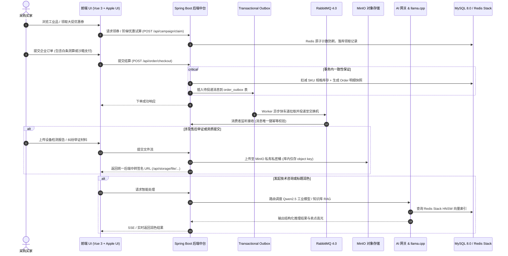

<div align="center">

# LANLinkshopping

### 聚合型一体多元化解决方案 · 现代化工业级 B2B 电商全栈中台平台

**Spring Boot 3.5.3 + Vue 3 (Vite 6) + Redis Stack HNSW + MinIO S3 + RabbitMQ 4.0 + 本地双大模型编排 + Dify 工作流 + Apple UI 交互规范**


[](https://x.com/Orion_Yves_Jude)
[](https://www.facebook.com/profile.php?id=61590596057471)

[功能特性](#-功能特性与业务矩阵) · [系统架构](#-系统架构与技术全景) · [开发文档](#-开发者工程手册与调试指南) · [快速开始](#-快速开始与环境部署) · [核心接口](#-核心接口速览) · [Twitter (X)](https://x.com/Orion_Yves_Jude) · [Facebook](https://www.facebook.com/profile.php?id=61590596057471) · [联系与声明](#-联系方式与原创声明) · [许可证](#-许可证说明)

</div>

---

## 📖 项目简介与系统定位

**LANLinkshopping** 是一个专为现代化工业供应链、大宗生产资料集采、企业协作与科技成果转化设计的**聚合型、多行业、B2B 一体化全栈电商中台平台**。项目深度覆盖 **“统一身份鉴权 · 商户自主入驻与资质审核 · 24 大行业商品商城 · 智能协同推荐 · 购物车 · 下单支付与对账履约”** 五大基础交易闭环，并在此基础上重磅演进出 **工业品技术服务交易中心、物流 GIS 轨迹与干线调度中枢、企业周期性订阅采购、企业信用白条测算器、售后多媒体证据链存证、大促主会场与领券中心、AI 智能商品标题润色、商品直播带货、Apple 拟态物理流体交互体系、本地双大模型编排（Qwen2.5-7B + Qwen2.5-VL）、MinIO 对象存储与 RabbitMQ 事务性消息队列** 等工业生产级工程中台能力。

### 🌟 项目核心交付形态体系

1. **Web 电商全栈主线**：基于 Spring Boot 3.5.3 + MyBatis-Plus + Vue 3（Vite 6 + Pinia + Ant Design Vue + Lucide 风格纯矢量图标）打造的高性能自适应平台。
2. **工业品技术服务与科技成果转化中台**：集成工业需求发布揭榜、科技成果鉴定评估、技术合同阶段里程碑与第三方资金托管、专家咨询库、中试基地测试预约及设备全生命周期托管维保。
3. **物流 GIS 轨迹与干线中枢**：内置 WGS84 / GCJ02 / BD09 坐标精密双向换算引擎，支持中国干线物流拓扑距离计算、沿途转运节点时序推演、停留超时与运单异常阻滞红黄灯预警调度。
4. **企业信用白条精准测算中枢**：企业信用等级评估模型、阶梯授信额度试算、T+30 / T+60 / T+90 账期账单管理与逾期罚息动态精算。
5. **售后全流程协商与多媒体证据链**：退款/退货/换货/上门返修多轨流转，买家/卖家/平台三方仲裁举证历史，通过 MinIO S3 私有桶签名中转实现多媒体安全存证。
6. **营销大促主会场与领券中心**：高并发领券防刷、阶梯满减/立减券包、下单实时券包试算与智能推荐。
7. **商品直播带货系统 (Live Commerce)**：支持企业开播、边播边卖互动商品货架、实时弹幕推流与观众互动热度统计。
8. **Apple UI 交互体验规范与新一代组件库**：macOS 拟态物理流体悬浮 Dock、iPhone 灵动岛交互胶囊、3D 景深卡片轮播、流体滑动 Tab（FluidAnimatedTabs）、光晕流光边框卡片（GlowBorderCard）、雷达脉冲状态徽章（RadarPulseBadge）及丝滑移动端抽屉（SmoothMobileDrawer）。
9. **企业级 AI 中枢与多智能体系统**：Docker 托管 llama.cpp 实现 Qwen2.5-7B（文本）与 Qwen2.5-VL（视觉多模态）双模型 Router 热切换调度，集成硬件显存感知调度器、Redis Stack HNSW 向量知识库（bge-m3 1024 维密集嵌入）、Dify 多智能体工作流与标准 MCP（Model Context Protocol）向量检索工具（`lanlink_kb_search`）。
10. **高可靠事务性中间件架构**：基于 MinIO 搭建 S3 兼容对象存储适配层（后端只读私有桶代理中转）；基于 RabbitMQ 4.0 实现 Transactional Outbox 事务外发模式，支持唯一 MessageID 消费去重与死信队列（`q.notify.dlq`）应急补偿。
11. **本地大模型微调与后训练工程**（`training/`）：沉淀基于 Unsloth / TRL 的 Qwen2.5-7B LoRA / SFT 意图微调工程、AGL/GRPO 强化学习闭环、冻结集基线评测与 GGUF 模型量化导出。
12. **全链路可观测性与韧性守护**（`monitoring/` & `scripts/`）：Prometheus 指标采集、Grafana 实时监控看板、混沌故障注入测试、守护进程健康看门狗与高并发压测基准。

> [!NOTE]
> 本项目为**教学 / 毕业设计演示项目**，默认运行在本地开发模式，请勿直接用于真实生产资金流交易或未经安全加固直接对外提供公共服务。

---

## 🏛️ 系统架构与技术全景

### 1. 总体架构拓扑图

```mermaid
flowchart TD
    subgraph Client["表现层 (Presentation Layer)"]
        WebDesktop["桌面端 Web (Vue 3 + Vite 6 + Ant Design Vue)"]
        WebMobile["移动端 H5 浏览器 (自适应低饱和度主题)"]
        AppleUI["Apple 拟态流体交互体系 (Dock / 灵动岛 / FluidTabs / GlowCard / 3D轮播)"]
    end

    subgraph Gateway["网关与网络接入层 (Gateway & Ingress)"]
        NginxIngress["Nginx 静态加速与反向代理 (Port: 5173 / 5174)"]
        SpringCloudGW["Spring Boot API 网关前置过滤器 (Context: /api)"]
        SecGuard["安全防线 (CSRF双提交 / TOTP 2FA / 阶梯限流 / AES-256-GCM / 防爆破)"]
    end

    subgraph BizHub["核心业务与高阶中台层 (Business Mid-Platform Layer)"]
        AuthSvc["统一鉴权中枢 (RBAC五级权限 / Google & Apple OAuth)"]
        MerchantSvc["商户管理中台 (企业入驻资质审核 / 店铺装修 / 自主发品)"]
        ProductSvc["商品与类目中枢 (24实体行业 / 多规格SKU / 阶梯批发价)"]
        TechSvc["工业品技术服务中台 (合同流转 / 里程碑验收 / 资金托管 / 专家诊断 / 中试预约)"]
        GisLogisticsSvc["物流 GIS 调度中枢 (WGS84-GCJ02-BD09 互转 / 干线路由演进 / 阻滞异常预警)"]
        OrderPaySvc["交易与支付中枢 (原子库存扣减 / 沙箱收银台 / 信用白条测算)"]
        CampaignSvc["营销大促与券包中心 (大促主会场 / 阶梯满减券 / 批量抢券防刷)"]
        SubscriptionSvc["企业周期性订阅采购 (周/月易耗品备件定期补货待办)"]
        RefundDisputeSvc["售后协商与证据链中台 (退换修全轨流转 / 多媒体防篡改举证)"]
        LiveSvc["商品直播带货中枢 (推流大厅 / 边播边买货架 / 实时弹幕热度)"]
        RiskSvc["实时风控与安全审计 (高频刷单拦截 / 异常IP预警)"]
        AbSvc["A/B 测试实验中台 (流量分桶 / 指标埋点)"]
    end

    subgraph MidLayer["事务性中间件与流处理层 (Middleware & Async Pipeline)"]
        OutboxWorkers["Transactional Outbox 投递工作器 (OrderOutbox & NotifyOutbox)"]
        RabbitMQCluster["RabbitMQ 4.0 (Topic交换机 / 消费端唯一键去重 / q.notify.dlq 死信兜底)"]
        MinIOS3["MinIO S3 对象存储 (资质证书 / 维修工单原件 / 后端只读中转端点)"]
        MailpitSvc["Mailpit 本地邮件调试与通知沙箱"]
    end

    subgraph AIHub["AI 与多智能体中枢 (AI & Multi-Agent Hub)"]
        AiGateway["FastAPI AI 网关 (/v1/chat/completions + Tool Calling)"]
        ModelRouter["llama.cpp 双模型 Router (Qwen2.5-7B + Qwen2.5-VL 热切换)"]
        HwScheduler["硬件感知调度器 (GPU显存自适应 + 多层CPU卸载 + 状态感知)"]
        DifyWorkflow["Dify 多智能体工作流 (采购意图识别 / 寻源比价 / 售后协同)"]
        McpBridge["MCP 协议工具桥 (lanlink_kb_search 只读向量库工具 / OpenAPI 标准)"]
        AiTitleEngine["AI 智能商品标题润色 (工业规格标准化 / 卖点提炼 / SEO 重构)"]
        SupportRAG["智能客服 RAG (本地知识库优先 + 外接兜底 + PII 脱敏守卫)"]
        PostTrain["本地模型微调后训练工程 (LoRA / SFT / GRPO / GGUF回灌)"]
    end

    subgraph DataHub["数据与存储中枢 (Data & Storage Layer)"]
        MySQLStore["MySQL 8.0 核心业务持久化 (InnoDB 行级锁 / 事务强一致性)"]
        RedisHNSW["Redis Stack 7.4 (HNSW 向量索引 aikb-idx + 分布式缓存 + 限流计数器)"]
        EmbeddingEngine["bge-m3 本地密集向量嵌入引擎 (1024 维)"]
    end

    subgraph Observability["可观测性与韧性守护 (Observability & Reliability)"]
        PrometheusNode["Prometheus 核心指标采集 (QPS / TPS / 延迟 / 显存)"]
        GrafanaDash["Grafana 性能监控看板"]
        AdminMetricsView["管理端实时监控大屏 (AdminMetrics.vue)"]
        ChaosTest["混沌工程自愈演练 & 守护看门狗 (Watchdog)"]
    end

    Client --> Gateway
    Gateway --> BizHub
    BizHub --> MidLayer
    MidLayer --> BizHub
    BizHub --> AIHub
    BizHub --> DataHub
    AIHub --> DataHub
    BizHub -.-> Observability
    MidLayer -.-> Observability
    AIHub -.-> Observability
```



---

### 2. 核心业务全景时序交互



---

### 3. 全技术栈清单速览

| 维度 | 技术选型 | 版本/规范 | 架构作用与定位 |
|------|---------|-----------|----------------|
| **后端主框架** | Spring Boot | 3.5.3 (Java 17 LTS) | 核心微服务与单体应用容器底座，高性能异步通信 |
| | MyBatis-Plus | 3.5.10.1+ | 实体持久化、分页防 SQL 注入与动态条件封装 |
| | Spring Security | 6.x | RBAC 五级鉴权、BCrypt 强密码加盐、TOTP 双因素安全认证 |
| | Spring Cloud | 2025.1.x (演进骨架) | 预研微服务骨架（Nacos 注册中心、Gateway、OpenFeign） |
| **前端体系** | Vue.js | 3.5.x (组合式 API) | 现代化响应式框架，模块化单文件组件 (SFC) |
| | 构建工具 | Vite 6.4.5 | 极速 ESM 开发冷启动、HMR 热更新、Rollup 生产分包优化 |
| | UI 组件库 | Ant Design Vue 4.x | 企业级中后台高质感 UI 交互控件库 |
| | 矢量图标 | Lucide Vue Next | 全站纯矢量 SVG 统一映射治理，无任何 Emoji 字符滥用 |
| | 状态与路由 | Pinia + Vue Router 4.x | 全局响应式状态共享、路由守卫与平滑滚动记忆 |
| **消息与存储** | 对象存储 | MinIO (S3 兼容) + AWS SDK v2 2.57.8 | 商户资质与技术服务材料加密存储；私有桶后端安全代理出站 |
| | 消息队列 | RabbitMQ 4.0 (`rabbitmq:4-management`) | 事务外发模式（Transactional Outbox）、唯一键去重、死信兜底 |
| | 数据库 | MySQL 8.0+ (InnoDB) | 行级排他锁、多表事务 ACID 保证、索引与外键约束优化 |
| | 缓存与向量库 | Redis Stack 7.4 (RediSearch) | 整合 HNSW 向量索引、分布式缓存、分布式限流原子计数 |
| **AI / 大模型** | 推理底座 | llama.cpp (Docker) | 本地运行 Qwen2.5-7B (文本) 与 Qwen2.5-VL (视觉) GGUF 模型 |
| | AI 网关 | FastAPI + Uvicorn | 兼容 OpenAI 标准 API、多工具调用 (Tool Calling)、流式输出 |
| | 向量嵌入 | BAAI/bge-m3 | 1024 维多语言高维密集向量嵌入模型 |
| | 多智能体编排 | Dify DSL + MCP | 编排多 Agent 协作工作流；标准 MCP 协议只读向量检索 (`lanlink_kb_search`) |
| | 模型微调强化 | Unsloth + TRL + PyTorch | 工业意图分类 LoRA SFT 微调、AGL/GRPO 强化学习闭环与量化导出 |
| **运维与观测** | 指标与看板 | Prometheus + Grafana | 核心吞吐率 (QPS/TPS)、P99 延迟、GPU 显存占用与显卡温度监控 |
| | 韧性与自愈 | Chaos / Watchdog | 混沌故障断网宕机演练、守护进程健康探活与故障自愈 |

---

## ✨ 核心业务与高阶微中台能力矩阵

### 1. 基础交易全闭环（五大核心模块）

| 模块 | 代码入口与核心类 | 能力与业务特性 |
|------|-----------------|----------------|
| 🔐 **登录鉴权中心** | [`UserController.java`](file:///d:/桌面/LANLinkShopping/Shopping/backend/src/main/java/com/lanlink/shopping/controller/UserController.java)<br>[`AuthInterceptor.java`](file:///d:/桌面/LANLinkShopping/Shopping/backend/src/main/java/com/lanlink/shopping/config/AuthInterceptor.java) | 手机号注册/登录、RBAC 五级权限矩阵（`GUEST` / `BUYER` / `VIP` / `MERCHANT` / `ADMIN`）、TOTP 双因素安全验证（2FA）、CSRF 双提交防护、密码连续错误阶梯锁定、社交登录授权预留。 |
| 🏪 **商户入驻中台** | [`MerchantCenterController.java`](file:///d:/桌面/LANLinkShopping/Shopping/backend/src/main/java/com/lanlink/shopping/controller/MerchantCenterController.java)<br>[`MerchantApply.vue`](file:///d:/桌面/LANLinkShopping/Shopping/frontend/src/views/MerchantApply.vue) | 企业入驻在线申请（统一社会信用代码合规校验、营业执照 MinIO 存证）、智能合规初筛模型（注册资本与纳税等级自动过审）、商户独立管理后台（店铺配置、商品上架、营销活动申报、直播推流管理）。 |
| 🛍️ **多元商品商城** | [`ProductController.java`](file:///d:/桌面/LANLinkShopping/Shopping/backend/src/main/java/com/lanlink/shopping/controller/ProductController.java)<br>[`Mall.vue`](file:///d:/桌面/LANLinkShopping/Shopping/frontend/src/views/Mall.vue) | 24 大实体行业多级分类索引、阶梯批发价（大宗采购起订量与梯度折扣）、多规格 SKU 体系、商品审核流、价格走势日 K 线行情看板。 |
| 🛒 **智能购物车** | [`Cart.vue`](file:///d:/桌面/LANLinkShopping/Shopping/frontend/src/views/Cart.vue) | 原子级规格库存校验、大宗批发批量修改数量、一键全选/按店铺勾选结算、企业收货地址中枢联动与运费预估。 |
| 📦 **下单支付履约** | [`OrderController.java`](file:///d:/桌面/LANLinkShopping/Shopping/backend/src/main/java/com/lanlink/shopping/controller/OrderController.java)<br>[`Checkout.vue`](file:///d:/桌面/LANLinkShopping/Shopping/frontend/src/views/Checkout.vue) | 分布式/事务原子扣减库存、订单全明细快照持久化、支付宝 / 微信 / 余额沙箱 Mock 支付、企业积分抵扣（1000 积分 = 1 元）、企业白条账期授信延期结账。 |

---

### 2. 工业品技术服务与科技成果转化中台

模块全景位于 [`com.lanlink.shopping.module.techservice`](file:///d:/桌面/LANLinkShopping/Shopping/backend/src/main/java/com/lanlink/shopping/module/techservice)，前端入口位于 [`frontend/src/views/techservice/`](file:///d:/桌面/LANLinkShopping/Shopping/frontend/src/views/techservice/) 及管理后台 [`AdminTechService.vue`](file:///d:/桌面/LANLinkShopping/Shopping/frontend/src/views/admin/AdminTechService.vue)：

- **工业技术交易与合同生命周期**（[`TechContracts.vue`](file:///d:/桌面/LANLinkShopping/Shopping/frontend/src/views/techservice/TechContracts.vue) & [`TechContractService.java`](file:///d:/桌面/LANLinkShopping/Shopping/backend/src/main/java/com/lanlink/shopping/module/techservice/service/TechContractService.java)）：支持工业企业与技术服务商签订法律电子合同，定义阶段性技术里程碑（`TechMilestone`），绑定第三方资金存管托管流水（`TechEscrowLedger`），达成节点验收（`TechAcceptance`）后逐阶段放款。
- **工业专家库与在线诊断咨询**（[`TechExperts.vue`](file:///d:/桌面/LANLinkShopping/Shopping/frontend/src/views/techservice/TechExperts.vue) & `TechExpertService.java`）：汇聚高校科研人员、大国工匠与认证技术专家，提供在线预约、工况参数预检、技术方案出具与付费问答。
- **中试基地与共享实验室预约**（[`TechPilot.vue`](file:///d:/桌面/LANLinkShopping/Shopping/frontend/src/views/techservice/TechPilot.vue) & `TechPilotService.java`）：大型工业设备中试线、高精尖检测仪器排期共享，在线预约工位与试验时段。
- **企业技术攻关需求揭榜挂帅**（[`TechDemands.vue`](file:///d:/桌面/LANLinkShopping/Shopping/frontend/src/views/techservice/TechDemands.vue) & `TechDemandService.java`）：发布“卡脖子”技术难题与技术改造需求，设定悬赏预算与交付周期，面向全行业公开竞标与技术对接。
- **科技成果鉴定与评估**（[`TechAppraisal.vue`](file:///d:/桌面/LANLinkShopping/Shopping/frontend/src/views/techservice/TechAppraisal.vue) & `TechAppraisal`）：成果技术成熟度（TRL）、商业化前景与专利价值多维评估报告出具。
- **工业设备全生命周期托管维保**（[`TechHosting.vue`](file:///d:/桌面/LANLinkShopping/Shopping/frontend/src/views/techservice/TechHosting.vue)）：设备台账档案、定期巡检巡查维保计划、工单指派、备件更换记录与上门服务核销。

---

### 3. 物流 GIS 轨迹与干线中枢

位于前端 [`frontend/src/utils/logisticsGis.js`](file:///d:/桌面/LANLinkShopping/Shopping/frontend/src/utils/logisticsGis.js)、[`logisticsRoute.js`](file:///d:/桌面/LANLinkShopping/Shopping/frontend/src/utils/logisticsRoute.js)、[`chinaMapData.js`](file:///d:/桌面/LANLinkShopping/Shopping/frontend/src/utils/chinaMapData.js) 与后端 [`LogisticsAdminController.java`](file:///d:/桌面/LANLinkShopping/Shopping/backend/src/main/java/com/lanlink/shopping/controller/LogisticsAdminController.java)：

- **高精坐标双向换算引擎**（[`coordTransform.js`](file:///d:/桌面/LANLinkShopping/Shopping/frontend/src/utils/coordTransform.js)）：无缝处理 GPS 原始坐标（WGS-84）、国家测绘局加密坐标（GCJ-02 火星坐标）与百度坐标（BD-09）的高精度双向互转与中国大陆境外越界检测。
- **全国干线拓扑路由演进**：基于大圆距离 Haversine 算法与公路绕行修正因子，智能测算全国转运枢纽间物理里程，推演在途节点推进时序。
- **运单异常阻滞与超时预警中枢**（[`AdminTrackingExceptions.vue`](file:///d:/桌面/LANLinkShopping/Shopping/frontend/src/views/admin/AdminTrackingExceptions.vue)）：全天候监测运单在途轨迹；运单在单个中转节点停留超过 24 小时自动触发黄灯警示，超过 48 小时触发红灯紧急调度告警，支持运营端一键催件、改派与干线转运异常重定向。
- **对账结算单自动化**：按物流服务商与账期周期聚合已签收运单，支持批量对账单核算、扣减费用与附加险申报。

---

### 4. 营销大促主会场与领券中心

- **大促主会场聚合**（[`CampaignVenue.vue`](file:///d:/桌面/LANLinkShopping/Shopping/frontend/src/views/CampaignVenue.vue)）：集纳各行业大促爆品、限时满减会场、主推工业品首发专区。
- **高并发领券中心**（[`CouponCenter.vue`](file:///d:/桌面/LANLinkShopping/Shopping/frontend/src/views/CouponCenter.vue) & [`AdCampaignController.java`](file:///d:/桌面/LANLinkShopping/Shopping/backend/src/main/java/com/lanlink/shopping/controller/AdCampaignController.java)）：支持阶梯满减券、新人专享券与限时折扣券一键批量领取，基于 Redis 原子计数防刷拦截。
- **结算实时计价门面**（[`PricingFacade.java`](file:///d:/桌面/LANLinkShopping/Shopping/backend/src/main/java/com/lanlink/shopping/integration/pricing/PricingFacade.java) & [`CouponQuoteDTO.java`](file:///d:/桌面/LANLinkShopping/Shopping/backend/src/main/java/com/lanlink/shopping/dto/CouponQuoteDTO.java)）：下单结算时自动匹配最优券包组合，并联动 [`CampaignOrderListener.java`](file:///d:/桌面/LANLinkShopping/Shopping/backend/src/main/java/com/lanlink/shopping/integration/listener/CampaignOrderListener.java) 完成订单支付后的优惠券状态核销。

---

### 5. 企业周期性订阅采购与任务中心

- **周期性订阅采购**（[`SubscriptionOrders.vue`](file:///d:/桌面/LANLinkShopping/Shopping/frontend/src/views/SubscriptionOrders.vue)）：针对企业高频易耗品（工业劳保、机床润滑油脂、传动件等），支持设置按周/按月定期自动生成采购订单草稿，提醒采购专员一键确认付款，避免生产断料。
- **会员任务与权益中心**（[`TaskCenter.vue`](file:///d:/桌面/LANLinkShopping/Shopping/frontend/src/views/TaskCenter.vue) & [`MembershipOrderListener.java`](file:///d:/桌面/LANLinkShopping/Shopping/backend/src/main/java/com/lanlink/shopping/integration/listener/MembershipOrderListener.java)）：阶梯成长体系（`BUYER` → `VIP`），完成首单、大宗采买、评价互动可解锁专属积分返点与白条提额权益。

---

### 6. 企业信用白条精准测算器与风控引擎

- **白条授信精准测算器**（[`creditCalculator.js`](file:///d:/桌面/LANLinkShopping/Shopping/frontend/src/utils/creditCalculator.js) & [`CreditTermCenter.vue`](file:///d:/桌面/LANLinkShopping/Shopping/frontend/src/views/CreditTermCenter.vue)）：基于企业注册资本、开票历史、履约评级与历史采购频次构建多因子评分矩阵，输出动态信用额度建议（最高 500 万元）。
- **账期日历与阶梯滞纳金精算**：支持 T+30 / T+60 / T+90 灵活账期，账期内免息；若发生逾期，按日万分之五基准利率结合逾期天数阶梯计息，并在收银台自动拦截未结清逾期账户。

---

### 7. 售后全流程协商与多媒体证据链存证

- **全轨纠纷流转**（[`OrderDetail.vue`](file:///d:/桌面/LANLinkShopping/Shopping/frontend/src/views/OrderDetail.vue) & `components/refund/`）：支持仅退款、退货退款、破损补寄与上门返修全流程流转。
- **多媒体证据链合规存证**（[`refundEvidence.js`](file:///d:/桌面/LANLinkShopping/Shopping/frontend/src/utils/refundEvidence.js)）：买家、商家与平台客服可在工单中上传设备损毁照片、检测报告与维修视频。附件直连 MinIO S3 私有加密桶，前端渲染走后端防盗链中转，确保商业举证材料不可篡改、安全保密。

---

### 8. AI 智能商品标题润色与卖点高光

- **工业品 AI 润色引擎**（[`AiTitlePolish.vue`](file:///d:/桌面/LANLinkShopping/Shopping/frontend/src/components/merchant/AiTitlePolish.vue) & [`aiPolish.js`](file:///d:/桌面/LANLinkShopping/Shopping/frontend/src/utils/aiPolish.js)）：依托本地 Qwen2.5 工业大模型，为商户解决工业品命名不规范难题。自动提取“品牌 + 核心型号 + 工业规格 + 执行标准 + 适用场景”，过滤夸大极限词，重组为符合 B2B SEO 检索权重的标准化爆款标题，并一键提炼核心卖点高光标签。

---

### 9. Apple UI 拟态流体交互规范与新一代组件库

秉承 Apple Human Interface Guidelines 工业设计哲学，全站集成新一代纯矢量拟态交互体系：

- **macOS 拟态物理流体 Dock**（[`AppleDock.vue`](file:///d:/桌面/LANLinkShopping/Shopping/frontend/src/components/ui/AppleDock.vue)）：流体物理弹性缩放动画、平滑贝塞尔曲线微交互。
- **iPhone 灵动岛交互胶囊**（[`AppleDynamicIsland.vue`](file:///d:/桌面/LANLinkShopping/Shopping/frontend/src/components/ui/AppleDynamicIsland.vue)）：悬浮消息通知胶囊、状态变换弹性伸缩动效。
- **流体滑动选项卡**（[`FluidAnimatedTabs.vue`](file:///d:/桌面/LANLinkShopping/Shopping/frontend/src/components/ui/FluidAnimatedTabs.vue)）：带物理惯性的自适应滑块背景，切换丝滑无缝。
- **光晕流光边框卡片**（[`GlowBorderCard.vue`](file:///d:/桌面/LANLinkShopping/Shopping/frontend/src/components/ui/GlowBorderCard.vue)）：跟随光标移动的流光渐变边框，赋予工业硬核视觉未来感。
- **雷达涟漪状态徽章**（[`RadarPulseBadge.vue`](file:///d:/桌面/LANLinkShopping/Shopping/frontend/src/components/ui/RadarPulseBadge.vue)）：用于展示实时在播、运单在途与工单紧急程度的动态脉冲光环。
- **丝滑触摸手势抽屉**（[`SmoothMobileDrawer.vue`](file:///d:/桌面/LANLinkShopping/Shopping/frontend/src/components/ui/SmoothMobileDrawer.vue)）：自适应移动端与平板触摸滑动手势抽屉，顺畅跟手回弹。
- **3D 景深卡片轮播**（[`AppleCardsCarousel.vue`](file:///d:/桌面/LANLinkShopping/Shopping/frontend/src/components/ui/AppleCardsCarousel.vue)）：视差平移动态光影、手势滑动支持。
- **纯矢量图标治理系统**（[`AppleIcon.vue`](file:///d:/桌面/LANLinkShopping/Shopping/frontend/src/components/ui/AppleIcon.vue)）：集中映射 Lucide SVG 图标，彻底杜绝 Emoji 乱象。

---

### 10. 本地双大模型编排与 MCP 向量中枢

- **双模型 Router 架构**：Docker 部署 llama.cpp，运行时支持按请求意图无缝调度 **Qwen2.5-7B（大语言模型）** 与 **Qwen2.5-VL（视觉多模态大模型）**。
- **硬件显存自适应调度器**（[`hardware_scheduler.py`](file:///d:/桌面/LANLinkShopping/Shopping/ai-gateway/hardware_scheduler.py)）：实时感知 GPU 显存与温度；优先全显存加载，显存轻微不足时自动进行 CPU 卸载辅助，告急时主动启动降级保护；支持 `GET /v1/hardware` 查询调度依据。
- **网关侧只读向量库 MCP 工具**（[`ai-gateway/MCP_KB_SPEC.md`](file:///d:/桌面/LANLinkShopping/Shopping/ai-gateway/MCP_KB_SPEC.md)）：暴露 `lanlink_kb_search` 标准 MCP 工具，外部智能体可直接经 `/mcp` 端点以工具调用方式检索共享向量索引 `aikb-idx`。

---

## 🛠️ 开发者工程手册与调试指南

### 1. 本地网络拓扑与端口监听矩阵

在本地完整拉起全栈后，所有核心组件的端口分配与网络隔离规则如下表所示：

| 端口 | 服务名称 | 进程/容器 | 绑定范围 | 核心用途与调试说明 |
|:---:|:---|:---|:---:|:---|
| **8080** | Spring Boot 后端 | `java.exe` | `127.0.0.1` | 业务中台核心 RESTful API，全局 Context-Path 为 `/api` |
| **5173** | 前端静态加速 / 局域网验收 | `nginx` (Docker) | `0.0.0.0` (所有网卡) | 移动端真机访问 `http://<本机IP>:5173` 测试低饱和响应式布局 |
| **5174** | 前端开发调试服务器 | `Vite` | `127.0.0.1` | 热重载开发端口，通过 `/api` 代理转发至后端 8080 |
| **3306** | MySQL 8.0 | `mysqld` / Docker | `127.0.0.1` | 业务持久化数据库，字符集 `utf8mb4_unicode_ci` |
| **6379** | Redis Stack 7.4 | `redis-stack-server` | `127.0.0.1` | RediSearch 模块，承载 `aikb-idx` 1024 维 HNSW 向量索引与全局缓存 |
| **9000** | MinIO S3 API | `minio` (Docker) | `127.0.0.1` | S3 兼容对象存储 API，后端 [`StorageService`](file:///d:/桌面/LANLinkShopping/Shopping/backend/src/main/java/com/lanlink/shopping/common/storage/StorageService.java) 走此端口读写 |
| **9001** | MinIO Web 控制台 | `minio` (Docker) | `127.0.0.1` | 对象存储可视化管理面板，管理存储桶与对象访问策略 |
| **5672** | RabbitMQ AMQP | `rabbitmq` (Docker) | `127.0.0.1` | AMQP 协议客户端连接端口，生产者与消费者双向通道 |
| **15672** | RabbitMQ 管理后台 | `rabbitmq` (Docker) | `127.0.0.1` | 队列监控大屏，实时查看消息堆积、消费速率与死信队列 `q.notify.dlq` |
| **18123** | llama.cpp 推理底座 | `llama-cpp` (Docker) | `127.0.0.1` | 容器内 8123 映射至宿主 18123，承载 GGUF 双模型推理 |
| **1025** | Mailpit SMTP | `mailpit` (Docker) | `127.0.0.1` | 本地测试邮件投递端口 |
| **8081** | Mailpit Web 邮箱 | `mailpit` (Docker) | `127.0.0.1` | 本地邮件网页收件箱（容器内 8025），实时拦截系统验证码邮件 |
| **3000** | 批量导入 Workflow | Node.js Worker | `127.0.0.1` | 大宗商品与采购单批量导入工作流服务 |

> [!IMPORTANT]
> 除用于局域网多设备真机验收的前端端口绑定所有网卡外，数据库、缓存、对象存储、消息队列与 AI 服务**严格仅绑定 `127.0.0.1` 本地回环地址**，防止局域网端口探测与越权穿透。

---

### 2. 环境变量与凭据配置规范（`.env`）

项目严格遵循 **12-Factor App** 配置规范，根目录 `.env.example` 提供了全部必填项与配置注释：

```env
# ==============================================================================
# 1. 核心关系型数据库 (MySQL 8.0)
# ==============================================================================
SPRING_DATASOURCE_URL=jdbc:mysql://localhost:3306/lanlink_shopping?useUnicode=true&characterEncoding=utf8&serverTimezone=Asia/Shanghai&useSSL=false&allowPublicKeyRetrieval=true&createDatabaseIfNotExist=true
SPRING_DATASOURCE_USERNAME=root
SPRING_DATASOURCE_PASSWORD=your_secure_mysql_password

# ==============================================================================
# 2. 高性能缓存与向量库 (Redis Stack HNSW)
# ==============================================================================
SPRING_DATA_REDIS_HOST=localhost
SPRING_DATA_REDIS_PORT=6379
SPRING_DATA_REDIS_PASSWORD=

# ==============================================================================
# 3. 本地大模型与推理底座 (llama.cpp / Ollama)
# ==============================================================================
LLM_BACKEND=llamacpp
LLAMACPP_HOST=localhost
LLAMACPP_PORT=18123

# ==============================================================================
# 4. S3 兼容对象存储 (MinIO / 腾讯 COS / 阿里 OSS)
# ==============================================================================
MINIO_ROOT_USER=lanlink_admin
MINIO_ROOT_PASSWORD=lanlink_storage_password_123
LANLINK_STORAGE_ENABLED=true
LANLINK_S3_BUCKET=products
LANLINK_S3_PATH_STYLE=true
# 切换公有云 OSS/COS 时仅需修改 LANLINK_S3_ENDPOINT 与 AccessKey，业务代码零改动

# ==============================================================================
# 5. 消息队列 (RabbitMQ 4.0) 与双链路开关
# ==============================================================================
RABBITMQ_USER=lanlink_mq
RABBITMQ_PASSWORD=lanlink_mq_password_123
# 通道模式开关：mq = 经由 RabbitMQ 投递（生产模式）；event = 回退至本地 Spring Event 内存总线
LANLINK_MQ_ORDER_FLOW=mq
LANLINK_MQ_NOTIFY_FLOW=mq
```

> [!WARNING]
> `docker-compose.yml` 对存储与消息队列凭据启用了 `${VAR:?...}` 强约束校验。若本地缺少 `.env` 或关键口令为空，执行 `docker compose up` 将会立即拦截阻断并显式报错，避免由于缺失凭据导致后端静默故障。切勿将含有真实密码的 `.env` 提交至版本管理。

---

### 3. 高可靠事务性外发（Transactional Outbox）机制

为保证大促高并发交易场景下数据库更新与消息通知的**绝对最终一致性**，系统摒弃了不可靠的直接消息投递，全面落地 **Transactional Outbox 模式**：

1. **事务内原子持久化**：业务主逻辑（如用户下单、支付成功、工单推进）在同一个本地数据库事务中执行，同时向 `order_outbox` 或 `notify_outbox` 数据表写入一条状态为 `PENDING` 的待发送事件。
2. **异步快车道投递**：独立守护线程 [`OrderOutboxWorker.java`](file:///d:/桌面/LANLinkShopping/Shopping/backend/src/main/java/com/lanlink/shopping/integration/mq/OrderOutboxWorker.java) 监听事务提交后，立即以极短延迟批量抓取 `PENDING` 记录并推送到 RabbitMQ 交换机，发送成功后标记为 `SENT`。
3. **消费端幂等去重**：消费者在处理前从消息头中提取全局唯一 `messageId`，利用 Redis 分布式唯一记录校验幂等，彻底防止网络抖动导致的重复消费。
4. **死信队列（DLQ）重试与告警**：连续消费失败 3 次的消息自动转入死信队列 `q.notify.dlq`，运营管理后台可通过 [`AdminMqDlqController.java`](file:///d:/桌面/LANLinkShopping/Shopping/backend/src/main/java/com/lanlink/shopping/controller/AdminMqDlqController.java) 实时查询死信堆积并执行人工重新投递或异常标记。

---

### 4. 对象存储私有隔离与安全中转设计

商户营业执照、设备维保现场照片及售后多媒体证据属于高度企业敏感数据：
- MinIO 桶默认置为**私有只读（Private Read-Only）**，禁止互联网直接匿名访问原件。
- 前端上传由后端统一接收校验文件 MIME 类型、后缀名与魔数，通过 AWS S3 SDK v2 写入存储桶，数据库中仅存储统一标识 `object_key`。
- 前端请求查看原件时，必须携带有效 JWT 调用后端安全中转端点 `/api/storage/file/{key}`。后端验证当前登录用户的权限与租户隔离归属后，再流式中转输出资源，彻底根治越权水平遍历风险。

---

## 🚀 快速开始与环境部署

### 1. 前置依赖检查

| 组件要求 | 建议版本 | 校验命令 | 说明 |
|:---|:---|:---|:---|
| **JDK** | 17 LTS | `java -version` | 推荐 OpenJDK 17 / Eclipse Temurin 17 |
| **Maven** | 3.8+ | `mvn -version` | 项目自带完整 Maven Wrapper (`./mvnw`) |
| **Node.js** | 18+ / 20+ LTS | `node -v` | 前端工程与 Vite 构建环境 |
| **Docker & Compose** | 24+ / Compose v2 | `docker compose version` | 容器编排底座 |
| **MySQL** | 8.0+ | `mysql --version` | 核心业务数据库 |
| **Python** | 3.10+ / 3.12+ | `python --version` | AI 网关与混沌自动化测试工具 |

---

### 2. 本地一键启动（强烈推荐）

在 Windows 环境下，直接双击运行根目录的 **`启动本地环境.bat`**，或在 PowerShell 终端执行自动化初始化脚本：

```powershell
powershell -ExecutionPolicy Bypass -File start-local-env.ps1
```

> **自动化流水线动作**：
> 1. 读取 `.env` 变量完整性校验；
> 2. 检查 Docker 守护进程，拉起 Redis Stack、MinIO、RabbitMQ、Mailpit 与 llama.cpp；
> 3. 初始化并自动建表执行 `schema.sql`；
> 4. 启动 Spring Boot 后端工程（8080 端口）；
> 5. 启动 Vite 前端开发服务器（5174 / 5173 端口）；
> 6. 发起全链路健康心跳探针。

---

### 3. 手动分步启动步骤

#### 步骤一：拉起中间件基础设施容器
```bash
docker compose up -d
```
> 此命令将自动拉起 Redis Stack (6379)、MinIO (9000/9001)、RabbitMQ (5672/15672) 及 Mailpit (1025/8081)。

#### 步骤二：初始化数据库表结构与预置数据
后端在 `dev` 环境下默认配置了幂等初始化建表逻辑；如需使用原生客户端预导入：
```bash
mysql -uroot -p --default-character-set=utf8mb4 < backend/src/main/resources/sql/schema.sql
```

#### 步骤三：启动后端核心服务 (Port: 8080)
```bash
cd backend
mvn spring-boot:run -Dspring-boot.run.profiles=dev
```

#### 步骤四：启动前端现代化单页应用 (Port: 5174 / 5173)
```bash
cd frontend
npm install
npm run dev
```

启动成功后，浏览器访问 **`http://localhost:5174`**（或 `http://localhost:5173`）。移动端设备在同一局域网下可访问 `http://<本机局域网IP>:5173` 体验自适应界面。

---

## 🗂️ 仓库目录全景导览

```text
LANLinkshopping/
├── backend/                  # Spring Boot 3.5.3 后端工程核心
│   ├── src/main/java/com/lanlink/shopping/
│   │   ├── controller/       # 业务控制器（认证、商品、订单、直播、商户、物流、客服等）
│   │   ├── service/          # 核心业务服务契约与具体实现
│   │   ├── mapper/           # MyBatis-Plus 数据访问层接口
│   │   ├── entity/           # 数据库实体（User, Product, Order, Waybill, CreditAccount...）
│   │   ├── common/           # 全局工具、脱敏工具、R统一响应体、异常捕获、存储适配
│   │   │   └── storage/      # MinIO / S3 对象存储适配组件（StorageService.java）
│   │   ├── integration/      # 跨模块集成架构
│   │   │   ├── mq/           # RabbitMQ 事务外发 Worker、Outbox 实体与消费者
│   │   │   ├── listener/     # 订单活动与会员变更事件监听器
│   │   │   └── pricing/      # 营销优惠计价门面（PricingFacade.java）
│   │   ├── module/           # 高阶业务微中台独立包
│   │   │   ├── techservice/  # 工业品技术服务与科技成果转化中台（合同、里程碑、专家、中试、需求）
│   │   │   ├── ab/           # A/B 测试实验流量分桶中台
│   │   │   ├── aikb/         # 本地向量知识库引擎（HNSW 索引、密集向量嵌入、CDC 同步）
│   │   │   ├── campaign/     # 营销大促与优惠券中台
│   │   │   ├── membership/   # 企业会员成长与订阅采购中台
│   │   │   ├── notify/       # 统一站内信与通知队列中台
│   │   │   ├── pricemonitor/ # 价格情报雷达（五维加权因子、K 线走势预测）
│   │   │   ├── recommend/    # 智能协同推荐中台
│   │   │   └── risk/         # 实时交易风控中台
│   │   └── config/           # 安全配置、拦截器、跨域与 MyBatis 配置
│   └── src/main/resources/
│       ├── application.yml   # 核心配置文件
│       └── sql/schema.sql    # 幂等建表与预置演示数据 SQL
├── frontend/                 # Vue 3 + Vite 6 前端工程核心
│   ├── src/
│   │   ├── api/              # Axios 统一 API 客户端（包含各中台完整接口定义）
│   │   ├── components/       # 公共业务与交互组件
│   │   │   ├── ui/           # Apple 拟态纯矢量组件库（Dock、灵动岛、FluidTabs、GlowCard等）
│   │   │   ├── credit/       # 企业信用白条测算组件
│   │   │   ├── refund/       # 售后纠纷多媒体举证链组件
│   │   │   ├── merchant/     # 商户端组件（发品、发货、AI 标题润色 AiTitlePolish.vue）
│   │   │   └── techservice/  # 技术服务工单与阶段验收卡片
│   │   ├── views/            # 核心页面视图组件
│   │   │   ├── techservice/  # 工业技术服务中心（市场、专家、需求揭榜、合同、中试）
│   │   │   ├── admin/        # 管理后台视图（运营大屏、物流 GIS 异常、技术服务、知识库等）
│   │   │   ├── merchant/     # 商户中心视图（商品管理、出库物流、财务对账、店铺装修）
│   │   │   ├── live/         # 直播带货视图（LiveSquare.vue, LiveRoomView.vue）
│   │   │   └── ...           # 首页、商城、购物车、收银台、大促主会场、领券中心、任务中心
│   │   ├── store/            # Pinia 全局状态（用户、购物车、会员等）
│   │   └── utils/            # GIS 拓扑算法、坐标转换、白条计算器、用户行为埋点工具库
│   ├── public/products/      # 120+ 真实行业高清物料与 CREDITS.json 版权说明
│   └── vite.config.js        # Vite 构建反向代理与打包优化配置
├── ai-gateway/               # 本地 AI 网关沙盒工程 (FastAPI + Uvicorn)
│   ├── app/                  # 网关核心逻辑（Router、Memory、Tools、RedisKB）
│   ├── hardware_scheduler.py # GPU/CPU 硬件显存与温度感知调度中枢
│   └── MCP_KB_SPEC.md        # 标准 Model Context Protocol 向量检索工具规约
├── training/                 # 本地大模型微调与后训练工程
│   ├── agl_grpo_trainer.py   # GRPO 强化学习训练流水线
│   ├── train_intent_sft.py   # SFT 意图识别微调脚本
│   └── convert_gguf.sh       # LoRA 权重合并与 GGUF 模型量化导出
├── workflow/                 # 多智能体工作流编排（Dify Multi-Agent DSL）
├── monitoring/               # 可观测性套件配置（Prometheus 规则与 Grafana 看板）
├── scripts/                  # 运维自动化、混沌工程与测试脚本
│   ├── chaos_resilience_test.py  # 混沌工程故障演练
│   ├── daemon_health_watchdog.py # 守护看门狗自动化探活
│   ├── stress_benchmark.py       # 高并发压力测试脚本
│   └── build_china_map.py        # 全国物流 GIS 拓扑图谱生成器
├── docker-compose.yml        # 全栈基础设施容器集群编排
├── start-local-env.ps1       # Windows PowerShell 自动化全栈启动脚本
├── 启动本地环境.bat            # Windows 批处理快速双击启动
├── LICENSE                   # GNU General Public License v3.0 协议文件
└── README.md                 # 项目全景说明与开发手册
```

---

## 🧭 业务使用说明与演示账号

### 平台内置演示账号矩阵（初始密码统一为 `123456`）

| 手机号码 | 平台角色 | 演示业务场景与核心权限 |
|:---:|:---:|:---|
| **`13800000000`** | **平台运营 (ADMIN)** | 商户资质审核终审、工业技术服务商认证核销、商品发布监管、物流 GIS 异常调度大屏、全栈指标实时监控看板、AI 模型网关调度配置。 |
| **`13700000002`** | **商户卖家 (MERCHANT)** | 商户中心工作台、工业品发布、AI 标题一键润色、开播推流控制台、出库发货与轨迹录入、财务对账结算单查看。 |
| **`13900000001`** | **采购买家 (BUYER)** | 浏览 24 行业工业商城、协同个性化推荐、直播间边播边买、大促领券与满减结算、企业白条授信申请、发起技术服务工单与售后举证。 |

---

## 📡 核心 API 接口速览（统一前缀 `/api`）

| 业务领域 | 核心 Endpoint 规范 | 请求方式 | 业务功能说明 |
|:---|:---|:---:|:---|
| **统一鉴权** | `/auth/login`<br>`/auth/register`<br>`/auth/me` | `POST`<br>`POST`<br>`GET` | 用户手机号身份鉴权、账号注册、当前登录身份与权限矩阵获取 |
| **工业技术服务** | `/tech/contracts`<br>`/tech/experts`<br>`/tech/demands`<br>`/tech/pilot/bookings` | `GET/POST`<br>`GET`<br>`GET/POST`<br>`POST` | 技术服务电子合同签署与里程碑验收、专家咨询、技术需求揭榜挂帅、中试基地预约 |
| **物流 GIS 调度** | `/admin/logistics/waybills`<br>`/admin/logistics/exceptions`<br>`/admin/logistics/traces/sync` | `GET`<br>`GET`<br>`POST` | 运单生命周期跟踪、停留超时阻滞异常查询、干线节点轨迹批量推进同步 |
| **大促与领券** | `/campaign/list`<br>`/campaign/coupons/claim`<br>`/pricing/quote` | `GET`<br>`POST`<br>`POST` | 大促活动清单获取、阶梯优惠券批量秒杀领取、下单结算最佳优惠试算 |
| **企业信用白条** | `/credit/account/info`<br>`/credit/apply`<br>`/credit/bills` | `GET`<br>`POST`<br>`GET` | 企业白条额度查询、白条在线授信测算申请、历史周期性账单查询 |
| **AI 智能中枢** | `/support/ask`<br>`/v1/hardware`<br>`/mcp` | `POST`<br>`GET`<br>`POST` | 本地知识库客服问答、硬件调度状态感知、标准 MCP 工具调用协议入口 |
| **商品与交易** | `/product/page`<br>`/cart/add`<br>`/order/checkout`<br>`/order/pay/{orderNo}` | `GET`<br>`POST`<br>`POST`<br>`POST` | 商品多维度分页检索、购物车原子修改、事务原子下单结算、沙箱收银支付 |

---

## 🧪 自动化测试与质量保障体系

项目严格遵循测试驱动与质量分层防护原则，涵盖 200+ 单元测试与系统韧性测试套件：

```bash
# 1. 后端工程单元测试与集成测试（JUnit 5 + Spring Boot Test，包含 Outbox 与存储测试）
cd backend
mvn test

# 2. 前端单元测试与组件交互校验（Vitest）
cd frontend
npm test

# 3. 前端生产环境分包与构建编译验证
cd frontend
npm run build

# 4. 混沌工程韧性注入测试（断网模拟、Redis 故障、显存过载自愈验证）
python scripts/chaos_resilience_test.py

# 5. 高并发压力性能基准测试
python scripts/stress_benchmark.py

# 6. 守护看门狗自动化探活
python scripts/daemon_health_watchdog.py
```

---

## 🔒 全方位安全防护体系

1. **凭据安全与哈希防护**：用户密码采用强盐散列算法（`BCrypt`）加密存储；全面支持 Google Authenticator TOTP 两步认证（2FA）。
2. **敏感资产 AES-256-GCM 加密**：企业统一社会信用代码、银行账号、核心结算凭据使用底层 AES-256-GCM 算法加密落库。
3. **客服 PII 敏感信息实时脱敏**：智能客服与聊天交互全链路内置敏感词与隐私信息扫描器，出入站实时脱敏手机号、身份证与企业隐私字段。
4. **接口防护与风控拦截**：配置 CSRF 双提交校验拦截、IP 与用户阶梯滑动窗口限流防刷、连续密码错误防爆破锁定及实时交易风控事件审计。
5. **合规开源素材声明**：全站商品素材均符合开源商业友好授权并详尽归档于 [`frontend/public/products/CREDITS.json`](file:///d:/桌面/LANLinkShopping/Shopping/frontend/public/products/CREDITS.json)。

---

## 📬 联系方式与原创声明

### 👨‍💻 项目作者与联系方式

本项目由 **Jason Ouyang（欧阳）** 独立构思、架构设计与编码开发完成：

- **作者身份**：项目发起人 / 独立研发者（GitHub: [@c2jxmrywdn-del](https://github.com/c2jxmrywdn-del)）
- **主要邮箱**：[3514485358@qq.com](mailto:3514485358@qq.com)（日常项目交流、学术探讨与技术沟通）
- **X / Twitter**：[@Orion_Yves_Jude](https://x.com/Orion_Yves_Jude)
- **Facebook**：[Jason Ouyang](https://www.facebook.com/profile.php?id=61590596057471)
- **即时通讯**：WhatsApp · [OuyangJason](https://wa.me/OuyangJason?s=t) / 微信：`O19111295446`
- **开源主页**：[https://github.com/c2jxmrywdn-del/LANLinkshopping-Local-version](https://github.com/c2jxmrywdn-del/LANLinkshopping-Local-version)

---

### ⚠️ 原创性与法律权益严正声明（严禁商业化、冒用与盗用）

> [!CAUTION]
> **知识产权与维权警告**
> 
> 1. **原创毕业设计成果归属**：本项目（包含但不限于平台架构设计、技术选型方案、功能业务闭环、前端与移动端 UI/UX 视觉体系、Apple UI 组件库、后端微服务与 AI 沙盒代码实现、接口定义、数据库结构及相关说明文档）均为作者本人拥有独立知识产权与著作权的原创毕业设计成果。
> 2. **严禁商业化与营利性使用**：本项目仅限用于**个人技术学习、学术交流与毕业设计演示**用途。**未经作者本人明确的书面授权许可，任何组织、机构、团队或个人严禁将本项目源码、架构或衍生作品用于任何商业营利活动、付费课程、外包交付、商业 SaaS 售卖或商业产品包装推广**。
> 3. **严禁冒用、抄袭与剽窃盗用**：严禁任何人对本项目进行署名篡改、冒用作者身份、去除原作者版权信息、伪造成自身独立原创成果（包括但不限于将本项目用于各类高校毕业设计答辩、课程大作业提报、技术竞赛作品评奖等欺瞒行为）。
> 4. **维权与法律追责**：对于任何未经许可的盗用、剽窃、商业倒卖或冒用侵权行为，作者已对项目完整研发历程、代码提交历史及相关成果进行全网公证固证，并**保留采取发送律师函、向所在高校/工作单位/托管平台进行侵权举证下架，乃至依法向人民法院提起知识产权侵权诉讼追究法律赔偿责任等一切合法维权措施**。请共同尊重原创知识成果！

---

## 📄 许可证说明

本项目依据 **GNU General Public License v3.0（GNU GPL-3.0）** 开源协议授权发布。

```text
LANLinkshopping — 聚合型一体多元化解决方案 B2B 电商平台
Copyright (C) 2026 LANLinkshopping the sole editor

This program is free software: you can redistribute it and/or modify
it under the terms of the GNU General Public License as published by
the Free Software Foundation, either version 3 of the License, or
(at your option) any later version.
```

- 完整许可证协议文本详见根目录 [LICENSE](./LICENSE) 文件。
- **任何包含本项目源代码的衍生作品必须以相同的 GPL-3.0 协议开源**（强传染性 Copyleft 保障）。

---

<div align="center">

**特别感谢为 LANLinkshopping 提供支持的开源项目与生态技术社区：**
- [Microsoft Agent-Lightning](https://github.com/microsoft/agent-lightning) 团队对开源智能体生态的卓越贡献
- **Qwen 大模型开发团队** 对开源基础模型与多模态社区的技术支持
- [21st.dev](https://21st.dev) 提供的现代化交互设计灵感与开源组件支持

Made with ❤️ for Modern B2B E-Commerce & Open Innovation · 2026

</div>
