<div align="center">

# LANLinkshopping

### 聚合型一体多元化解决方案 · 现代化工业级 B2B 电商全栈中台平台

**Spring Boot 3.5.3 + Vue 3 (Vite 6) + Redis Stack HNSW + 本地双大模型编排 + Dify 工作流 + Apple UI 交互规范**


[](https://x.com/Orion_Yves_Jude)
[](https://www.facebook.com/profile.php?id=61590596057471)

[功能特性](#-功能特性) · [系统架构](#-系统架构与技术全景) · [快速开始](#-快速开始) · [使用说明](#-使用说明) · [核心接口速览](#-核心接口速览) · [Twitter (X)](https://x.com/Orion_Yves_Jude) · [Facebook](https://www.facebook.com/profile.php?id=61590596057471) · [联系与声明](#-联系方式与原创声明) · [许可证](#-许可证)

</div>

---

## 📖 项目简介与系统定位

**LANLinkshopping** 是一个专为现代化数字供应链、大宗工业品采购与多企业协同场景设计的**聚合型、多行业、B2B 一体化全栈电商中台平台**。项目深度覆盖 **“统一身份鉴权 · 商户自主入驻与资质审核 · 24 大行业商品商城 · 智能协同推荐 · 购物车 · 下单支付与对账履约”** 五大基础交易闭环，并深度集成了 **商品直播带货、Apple 拟态物理流体交互体系、本地大模型微调与强化学习、Dify 多智能体编排、全栈可观测性与监控预警** 等现代化生产级工程能力。

项目交付体系涵盖六大形态：
1. **Web 电商全栈主线**：基于 Spring Boot 3.5.3 + MyBatis-Plus + Vue 3（Vite 6 + Pinia + Ant Design Vue + Lucide 风格纯矢量图标）打造的高性能自适应平台。
2. **商品直播带货系统 (Live Commerce)**：支持企业开播、边播边卖互动商品货架、实时弹幕推流与观众互动热度统计。
3. **Apple UI 交互体验规范**：基于 Apple 设计语言打造的高斯毛玻璃、macOS 拟态物理流体 Dock 栏、iPhone 灵动岛通知胶囊与 3D 景深卡片轮播，全端（含手机浏览器 H5）自适应。
4. **企业级 AI 中枢与多智能体系统**：Docker 托管 llama.cpp 实现 Qwen2.5-7B（文本）与 Qwen2.5-VL（视觉多模态）双模型 Router 热切换调度，集成硬件显存感知调度器、Redis Stack HNSW 向量知识库（bge-m3 1024 维密集嵌入）与 Dify 多智能体工作流。
5. **本地大模型微调与后训练工程**（`training/`）：沉淀基于 Unsloth / TRL 的 Qwen2.5-7B LoRA / SFT 意图微调工程、AGL/GRPO 强化学习闭环、冻结集基线评测与 GGUF 模型量化导出。
6. **全链路可观测性与韧性守护**（`monitoring/` & `scripts/`）：Prometheus 指标采集、Grafana 实时监控看板、混沌故障注入测试、守护进程健康看门狗与高并发压测基准。

> 本项目为**教学 / 毕业设计演示项目**，默认运行在本地开发模式，请勿直接用于真实交易或对外提供生产级服务。

---

## 🏛️ 系统架构与技术全景

### 1. 系统总体逻辑架构

```mermaid
flowchart TD
    subgraph Client["表现层 (Presentation Layer)"]
        WebDesktop["桌面端 Web (Vue 3 + Vite 6 + Ant Design Vue)"]
        WebMobile["移动端 H5 浏览器 (自适应低饱和度主题)"]
        AppleUI["Apple UI 交互体系 (Dock / 灵动岛 / 3D轮播 / 纯矢量图标)"]
    end

    subgraph Gateway["网关与网络接入层 (Gateway & Ingress)"]
        NginxIngress["Nginx 静态加速与反向代理"]
        SpringCloudGW["Spring Cloud Gateway / 单体网关过滤器"]
        SecGuard["安全防线 (CSRF双提交 / TOTP 2FA / 阶梯限流 / 防爆破)"]
    end

    subgraph BizHub["核心业务中台层 (Business Services Layer)"]
        AuthSvc["认证与多端鉴权中枢 (RBAC / Google / Apple OAuth)"]
        MerchantSvc["商户中台 (入驻审核 / 店铺装修 / 资质过审)"]
        ProductSvc["商品与类目中枢 (24行业 / 多规格SKU / 阶梯批发价)"]
        LiveSvc["商品直播中枢 (实时推流 / 边播边卖 / 互动弹幕)"]
        OrderPaySvc["交易与支付中枢 (原子库存扣减 / 微信支付宝Mock / 账期白条)"]
        LogisticsSvc["履约物流中枢 (运单追踪 / 轨迹推进联动 / 账期对账单)"]
        MarketingSvc["营销与活动中台 (限时促销 / 满减立减券 / 积分商城)"]
        RecommendSvc["智能推荐中台 (协同过滤 / 热度加权 / 用户画像)"]
        RiskSvc["实时风控中台 (风险事件审计 / 刷单拦截)"]
        AbSvc["A/B 测试实验中台 (流量分桶 / 指标埋点)"]
    end

    subgraph AIHub["AI 与多智能体中枢 (AI & Agent Hub)"]
        AiGateway["FastAPI AI 网关 (/v1/chat/completions + Tool Calling)"]
        ModelRouter["llama.cpp 双模型 Router (Qwen2.5-7B + Qwen2.5-VL)"]
        HwScheduler["硬件感知调度器 (GPU显存自适应 + 多层CPU卸载)"]
        DifyWorkflow["Dify 多智能体工作流 (采购意图识别 / 寻源协调)"]
        McpBridge["MCP 协议工具桥 (Model Context Protocol / OpenAPI)"]
        SupportRAG["智能客服 RAG (本地知识库检索优先 + 主备链路守卫)"]
        PostTrain["本地模型微调工程 (LoRA / SFT / GRPO / GGUF回灌)"]
    end

    subgraph DataHub["数据与存储中枢 (Data & Storage Layer)"]
        MySQLStore["MySQL 8.0 核心业务持久化 (事务保证)"]
        RedisHNSW["Redis Stack (HNSW 向量索引 aikb-idx + 分布式缓存)"]
        EmbeddingEngine["bge-m3 本地密集向量嵌入引擎 (1024 维)"]
    end

    subgraph Observability["可观测性与韧性守护 (Observability & Reliability)"]
        PrometheusNode["Prometheus 核心指标采集"]
        GrafanaDash["Grafana 性能监控看板"]
        AdminMetricsView["管理端实时监控大屏 (QPS/TPS/显存/延迟)"]
        ChaosTest["混沌工程自愈演练 & 守护看门狗 (Watchdog)"]
    end

    Client --> Gateway
    Gateway --> BizHub
    BizHub --> AIHub
    BizHub --> DataHub
    AIHub --> DataHub
    BizHub -.-> Observability
    AIHub -.-> Observability
```



---

### 2. 技术栈清单

| 层次 | 技术选型 | 版本/规范 | 说明 |
|------|---------|-----------|------|
| **后端主线** | Spring Boot | 3.5.3 | 核心微服务与单体后端框架，Java 17 LTS |
| | MyBatis-Plus | 3.5.10.1+ | 实体持久化、分页插件与动态 SQL 封装 |
| | Spring Cloud | 2025.1.x (预研骨架) | 涵盖 Nacos 注册发现、Gateway、OpenFeign |
| | 安全鉴权 | Spring Security / BCrypt / TOTP | RBAC 五级角色、双因子认证、AES-256-GCM 敏感加密 |
| **前端主线** | Vue.js | 3.5.x (组合式 API) | 现代化响应式前端框架 |
| | 构建工具 | Vite 6.4.5 | 极速冷启动、HMR 与生产环境 Rollup 分包优化 |
| | UI 组件库 | Ant Design Vue 4.x | 企业级设计语言与基础组件 |
| | 矢量图标 | Lucide Vue Next | 全站 21st.dev 风格纯矢量 SVG，彻底摒弃原生 Emoji |
| | 状态与路由 | Pinia + Vue Router 4.x | 集中式响应式状态管理与导航守卫 |
| **AI / 大模型** | 推理底座 | llama.cpp (Docker) | 支持 GGUF 格式 Qwen2.5-7B 与 Qwen2.5-VL 热切换 |
| | AI 网关 | FastAPI + Uvicorn | 兼容 OpenAI `/v1/chat/completions`，支持工具调用与流式响应 |
| | 向量检索 | Redis Stack 7.4 (HNSW) | 1024 维向量索引，余弦相似度 + 中文分词混合召回 |
| | 向量嵌入 | BAAI/bge-m3 | 1024 维多语言密集向量嵌入模型 |
| | 智能体工作流 | Dify DSL + MCP | 标准化多智能体协同协议与工具调用标准 |
| | 模型后训练 | Unsloth + TRL + PyTorch | 意图分类 LoRA SFT、AGL/GRPO 强化学习循环 |
| **数据与运维** | 数据库 | MySQL 8.0+ | InnoDB 引擎、多表行锁、外键与索引优化 |
| | 缓存与消息 | Redis 7.0+ | 缓存、热点数据防击穿、分布式锁 |
| | 可观测性 | Prometheus + Grafana | 实时吞吐率、P99 延迟、GPU 显存/温度监控大屏 |
| | 韧性工程 | Chaos / Watchdog | 混沌故障演练、进程探活与自愈守护 |

---

## ✨ 核心业务与中台能力矩阵

### 1. 基础交易全闭环（五大核心模块）

| 模块 | 能力与特性 |
|------|-----------|
| 🔐 **登录鉴权中心** | 手机号注册/登录、RBAC 五级权限矩阵（`GUEST` / `BUYER` / `VIP` / `MERCHANT` / `ADMIN`）、TOTP 双因素安全验证（2FA）、CSRF 双提交防护、密码连续错误阶梯锁定、Google & Apple 社交登录授权预留 |
| 🏪 **商户入驻中台** | 企业入驻在线申请（统一社会信用代码、经营执照资质上传）、智能合规初筛模型（注册资本与纳税等级自动过审）、商户独立管理后台（`MerchantCenterLayout`：店铺配置、商品上架、营销活动申报、直播推流管理） |
| 🛍️ **多元商品商城** | 24 大实体行业多级分类索引、阶梯批发价（大宗采购起订量与梯度折扣）、多规格 SKU 体系、商品审核流、价格走势与日 K 线行情看板 |
| 🛒 **智能购物车** | 原子级规格库存校验、大宗批发批量修改数量、一键全选/按店铺勾选结算、企业收货地址中枢联动与运费预估 |
| 📦 **下单支付履约** | 分布式/事务原子扣减库存、订单全明细快照持久化、支付宝 / 微信 / 余额沙箱 Mock 支付、企业积分抵扣（1000 积分 = 1 元）、企业白条账期授信延期结账 |

---

### 2. 现代化增值与进阶中台

#### 🎥 商品直播带货系统 (Live Commerce)
- **企业级直播广场**：汇聚各行业在播商户，支持观看热度、开播状态实时检索。
- **沉浸式直播间**（`LiveRoomView.vue`）：定制化流媒体交互、毫秒级实时滚动互动弹幕与点赞动效流。
- **边播边卖互动货架**：主播端一键推送正在讲解的爆款商品，买家端弹窗即时查看规格并快捷下单。
- **商户与监管治理**：商户后台自主配置开播信息与关联带货商品，平台运营管理端实时巡查监管。

#### 🍎 Apple UI 交互规范与 21st.dev 纯矢量图标系统
- **纯矢量图标治理**：全面摒弃原生 Emoji 与字符替代方案，深度集成 21st.dev 风格的 Lucide SVG 矢量图标库，封装 [`AppleIcon.vue`](file:///d:/桌面/LANLinkShopping/Shopping/frontend/src/components/ui/AppleIcon.vue) 实现全站图标集中映射与规范化渲染。
- **macOS 拟态悬浮 Dock**（[`AppleDock.vue`](file:///d:/桌面/LANLinkShopping/Shopping/frontend/src/components/ui/AppleDock.vue)）：流体物理弹性缩放动画、平滑贝塞尔曲线微交互。
- **iPhone 灵动岛交互**（[`AppleDynamicIsland.vue`](file:///d:/桌面/LANLinkShopping/Shopping/frontend/src/components/ui/AppleDynamicIsland.vue)）：悬浮消息通知胶囊、状态变换弹性伸缩动效。
- **3D 景深卡片轮播**（[`AppleCardsCarousel.vue`](file:///d:/桌面/LANLinkShopping/Shopping/frontend/src/components/ui/AppleCardsCarousel.vue)）：视差平移动态光影、手势滑动支持。
- **高斯毛玻璃拟态质感**（[`AppleGlassCard.vue`](file:///d:/桌面/LANLinkShopping/Shopping/frontend/src/components/ui/AppleGlassCard.vue)）：背景多重模糊过滤、边缘渐变微光。
- **移动端全端响应式**：优化低饱和度色彩配比，自适应手机浏览器与宽屏显示，保障高对比度可读性与护眼视觉体验。

#### 🧠 企业级本地 AI 中枢与多智能体系统
- **本地向量知识库**：基于 Redis Stack HNSW 向量索引（`aikb-idx`）+ 本地 **bge-m3** 多语言嵌入模型（1024 维），结合「向量相似度 0.6 + 中文分词匹配 0.4」实现高精度 Hybrid 混合召回。
- **llama.cpp 双模型 Router 架构**：Docker 容器化管理 `llama-cpp`，支持按业务意图无缝热切换 **Qwen2.5-7B（大语言模型）** 与 **Qwen2.5-VL（视觉多模态模型）**。
- **硬件感知调度器**（`hardware_scheduler.py`）：实时感知 GPU 显存与温度；优先 GPU 全量加载，显存轻微不足时自动进行多层 CPU 卸载辅助，显存告急时提供明确多模态降级保护；支持 `GET /v1/hardware` 查询实时调度依据。
- **Dify 多智能体工作流**（`workflow/dify/lanlink_b2b_multi_agent_workflow.yml`）：编排采购意图识别、产品寻源、规格比对、售后答疑多 Agent 协作工作流。
- **标准化 MCP 协议集成**（`openapi/knowledge-tools.yaml` & `scripts/mcp_stdio_bridge.py`）：对齐 Anthropic Model Context Protocol 规范，开放标准知识库查询工具接口。
- **模型微调与强化学习**（`training/`）：基于 Unsloth / TRL 进行 LoRA / SFT 训练，配备 AGL/GRPO 奖励反馈闭环与冻结评测集，支持将微调模型量化导出为 GGUF 格式回灌到 llama.cpp。
- **智能客服主备链路架构**：本地知识库高精度问答优先，外接大模型智能兜底润色；内置敏感 PII 数据实时扫描脱敏与出站安全策略守卫；运营端可一键监控备用链路状态与拦截计数。

#### 🚚 履约物流与对账结算中枢
- **运单生命周期跟踪**：覆盖“待发货 → 已揽收 → 运输中 → 派件中 → 已签收 / 异常 / 退回 / 丢失”全状态机流转。
- **物流轨迹同步推进**：支持批量轨迹节点录入，签收节点自动解析并联动推进商城订单进入“已完成”状态。
- **服务商对账单批量生成**：支持按物流服务商与账期区间聚合已完结运单，支持扣减金额与附加费用核算，内置同周期幂等防重复生成校验。
- **售后索赔闭环**：支持物流异常与破损快速发起售后工单与金额赔付流转。

#### 🎯 电商高阶微中台新矩阵
- **A/B 测试实验中台** (`com.lanlink.shopping.module.ab`)：支持按流量比例分桶、多版本实验配置、转化率/点击率数据指标埋点收集。
- **智能协同推荐中台** (`com.lanlink.shopping.module.recommend`)：基于用户历史浏览/加购画像（`habitTracker.js`），结合协同过滤与热度加权输出千人千面推荐网格（`RecGrid.vue`）。
- **语义与多维搜索中台** (`com.lanlink.shopping.module.search`)：多字段分词倒排、类目智能映射与语义模糊召回。
- **实时交易风控中台** (`com.lanlink.shopping.module.risk`)：识别高频刷单、异常 IP、多设备并发登录等风险事件并执行实时告警与拦截。
- **营销大促与券包引擎** (`com.lanlink.shopping.module.campaign` & `CenterMarketing.vue`)：限时立减、满减满折优惠券发放、商户营销报名与核销。
- **价格情报与行情监控台** (`com.lanlink.shopping.module.pricemonitor`)：五维价格因子加权计算（市场情绪、供应链、基础原料、国际化、政策环境），生成日 K 线图谱与新闻源溯源。

#### 📊 可观测性、韧性与守护工程
- **Prometheus + Grafana 监控大屏**（`monitoring/`）：采集核心业务 QPS、TPS、接口延迟、模型推理耗时、GPU 显存占用与显卡温度。
- **运维管理看板**（`AdminMetrics.vue`）：在管理后台直观呈现系统健康状态、微服务节点可用性与实时警报。
- **守护看门狗**（`scripts/daemon_health_watchdog.py`）：后台服务健康探活，异常进程自动拉起。
- **混沌工程韧性测试**（`scripts/chaos_resilience_test.py`）：模拟网络断流、GPU 过热、Redis 宕机，检验系统故障隔离与优雅降级。
- **高并发压力测试**（`scripts/stress_benchmark.py`）：评估大促流量下系统的极限承载能力。

---

## 🗂️ 项目完整结构

```text
LANLinkshopping/
├── backend/                  # Spring Boot 3 后端核心应用
│   ├── src/main/java/com/lanlink/shopping/
│   │   ├── controller/       # 接口控制器（认证/商品/订单/直播/商户/管理/客服）
│   │   ├── service/          # 核心业务服务层与实现
│   │   ├── mapper/           # MyBatis-Plus 数据访问层
│   │   ├── entity/           # 数据库实体模型（User, LiveRoom, Product, Order, Waybill...）
│   │   ├── module/           # 高阶业务微中台模块
│   │   │   ├── ab/           # A/B 测试实验中台（AbTestService, AbController）
│   │   │   ├── aikb/         # 本地向量知识库（RedisVectorStore, EmbeddingService, RAG）
│   │   │   ├── campaign/     # 营销活动与券包中台（CampaignService, CampaignAdminController）
│   │   │   ├── membership/   # 会员成长与积分中台（MembershipService）
│   │   │   ├── pricemonitor/ # 价格情报雷达（PriceMonitorAiService, MarketNewsService）
│   │   │   ├── recommend/    # 智能协同推荐中台（RecommendService, RecommendStatMapper）
│   │   │   ├── risk/         # 实时交易风控中台（RiskEventService）
│   │   │   └── search/       # 语义多维搜索引擎（SearchService）
│   │   ├── support/          # 智能客服系统（意图识别/备用链路/策略守卫/出站配置）
│   │   ├── payment/          # 支付沙箱抽象层（微信/支付宝/余额）
│   │   └── config/           # 安全配置、拦截器、跨域与 MyBatis 配置
│   └── src/main/resources/
│       ├── application.yml   # 核心配置文件（默认 dev profile）
│       ├── application-dev.yml / application-prod.yml
│       ├── knowledge-base/   # 预置本地知识库 JSON 数据源
│       └── sql/              # schema.sql 数据库幂等建表与测试数据
├── frontend/                 # Vue 3 现代化前端应用
│   ├── src/
│   │   ├── api/              # Axios 统一接口封装（认证/商城/直播/物流/客服/营销/监控等）
│   │   ├── components/       # 公共业务组件
│   │   │   ├── ai/           # AI 智能助理交互组件
│   │   │   ├── ui/           # 21st.dev 风格 Apple UI 核心组件库
│   │   │   │   ├── AppleIcon.vue           # 集中式 Lucide 纯矢量 SVG 图标解析器
│   │   │   │   ├── AppleDock.vue           # macOS 风格流体悬浮导航栏
│   │   │   │   ├── AppleDynamicIsland.vue  # iPhone 灵动岛交互胶囊组件
│   │   │   │   ├── AppleCardsCarousel.vue  # 3D 视差卡片轮播组件
│   │   │   │   └── AppleGlassCard.vue      # 高级毛玻璃材质卡片
│   │   │   └── recommend/    # 智能协同推荐网格组件（RecGrid.vue）
│   │   ├── views/            # 页面视图组件
│   │   │   ├── live/         # 直播带货（LiveRoomView.vue）
│   │   │   ├── admin/        # 管理后台（运营仪表盘/物流履约/AI网关/可观测性大屏 AdminMetrics）
│   │   │   ├── center/       # 商户中心（店铺装修/商品发布/订单发货/营销推广）
│   │   │   └── ...           # 首页/商城/购物车/收银台/个人中心/活动中心/加入我们
│   │   ├── router/           # Vue Router 路由配置
│   │   ├── store/            # Pinia 全局状态管理
│   │   └── utils/            # 埋点上报、用户画像行为跟踪（habitTracker.js）与工具库
│   ├── public/products/      # 120+ 真实高清行业商品物料与 CREDITS.json 合规说明
│   ├── package.json          # 前端依赖（Lucide Vue Next, Ant Design Vue, Pinia 等）
│   └── vite.config.js        # Vite 构建与开发服务器反向代理配置
├── ai-gateway/               # 本地 AI 网关沙盒（FastAPI + llama.cpp / Ollama + RAG）
│   ├── app/                  # 网关核心逻辑（llm.py, memory.py, redis_kb.py, tools.py）
│   ├── hardware_scheduler.py # GPU/CPU 硬件感知调度中枢
│   └── docker-compose.yml    # AI 容器集群编排
├── training/                 # 本地模型微调与后训练工程（意图分类 LoRA / SFT / GRPO）
│   ├── agl_grpo_trainer.py   # GRPO 强化学习训练器
│   ├── train_intent_sft.py   # SFT 意图分类微调
│   ├── build_dataset.py      # 数据清洗与去泄漏切分
│   ├── eval_baseline.py      # 冻结基准集评估
│   └── convert_gguf.sh       # LoRA 权重合并与 GGUF 量化导出脚本
├── workflow/                 # 多智能体与工作流编排
│   └── dify/                 # Dify Multi-Agent Workflow DSL 配置
├── openapi/                  # 标准化 OpenAPI 与 MCP 协议工具定义
│   └── knowledge-tools.yaml  # 知识库工具 OpenAPI / MCP 规范文档
├── monitoring/               # 系统可观测性配置
│   ├── prometheus/           # Prometheus 采集规则与配置
│   └── grafana/              # Grafana 预置大屏仪表盘
├── scripts/                  # 运维保障与自动化演练脚本
│   ├── chaos_resilience_test.py      # 混沌工程韧性注入测试
│   ├── daemon_health_watchdog.py     # 守护进程健康监控看门狗
│   ├── mcp_stdio_bridge.py           # Model Context Protocol 标准输入输出桥接
│   ├── stress_benchmark.py           # 高并发性能基准压测
│   └── verify_kb_cdc_sync.py         # 知识库 CDC 数据变更实时同步校验
├── cloud/                    # Spring Cloud 微服务演进骨架（8 大模块 + Nacos）
├── docker-compose.yml        # Redis Stack HNSW 向量库 + llama.cpp 基础设施编排
├── docker-compose.local.yml  # 本地配套服务编排（Mailpit / 沙盒测试）
├── start-local-env.ps1       # Windows PowerShell 一键启动全栈脚本
├── 启动本地环境.bat            # Windows 批处理一键运行入口
├── LICENSE                   # GNU General Public License v3.0 开源协议
├── SECURITY.md               # 安全漏洞披露与响应规范
└── README.md                 # 项目使用与架构说明文档
```

---

## 🚀 快速开始

### 环境依赖

| 组件 | 版本建议 | 说明 |
|------|----------|------|
| **JDK** | 17+ | 推荐 Eclipse Temurin 17 或 Oracle JDK 17 |
| **Maven** | 3.8+ | 包含项目根目录 Maven Wrapper (`./mvnw`) |
| **Node.js** | 18+ / 20+ | 前端构建与运行环境 |
| **MySQL** | 8.0+ | 核心关系型数据库 |
| **Redis** | 7.0+ (Redis Stack) | 包含 RediSearch 模块，用于 HNSW 向量索引与分布式缓存 |
| **Docker** | 24+ | 用于运行 AI 沙盒、Redis Stack 向量库与监控组件 |
| **Python** | 3.10+ / 3.12+ | 用于运行 AI 网关、微调工程与演练脚本 |

---

### 1. 检出仓库代码

```bash
git clone https://github.com/c2jxmrywdn-del/LANLinkshopping-Local-version.git
cd LANLinkshopping-Local-version
```

### 2. 配置本地环境变量

复制模板并根据本地环境填写数据库与服务口令：

```bash
# Windows
copy .env.example .env

# macOS / Linux
cp .env.example .env
```

`.env` 核心基础配置示例：
```env
SPRING_DATASOURCE_URL=jdbc:mysql://localhost:3306/lanlink_shopping?useUnicode=true&characterEncoding=utf8&serverTimezone=Asia/Shanghai&useSSL=false&allowPublicKeyRetrieval=true&createDatabaseIfNotExist=true
SPRING_DATASOURCE_USERNAME=root
SPRING_DATASOURCE_PASSWORD=your_mysql_password

# Redis Stack 向量库
SPRING_DATA_REDIS_HOST=localhost
SPRING_DATA_REDIS_PORT=6379

# 本地大模型推理后端 (llamacpp / ollama / auto)
LLM_BACKEND=llamacpp
LLAMACPP_HOST=localhost
LLAMACPP_PORT=8081
```

---

### 3. 一键启动（推荐方案）

在 Windows 环境下，直接双击运行根目录的 **`启动本地环境.bat`**，或在终端执行：

```powershell
powershell -ExecutionPolicy Bypass -File start-local-env.ps1
```

> **启动脚本自动化流程**：读取 `.env` 环境变量 → 检查并拉起 Docker 基础设施（Redis Stack / llama.cpp）→ 启动 Spring Boot 后端（8080）→ 启动 Vite 前端（5173）→ 验证健康状态。

---

### 4. 手动分步启动

#### 步骤一：数据库初始化
后端在 `dev` 环境下已配置启动自动幂等执行 `schema.sql`，如需手动预导入：
```bash
mysql -uroot -p --default-character-set=utf8mb4 < backend/src/main/resources/sql/schema.sql
```

#### 步骤二：拉起基础设施容器 (Redis Stack & llama.cpp)
```bash
docker compose up -d
```

#### 步骤三：启动后端服务 (Port: 8080)
```bash
cd backend
mvn spring-boot:run -Dspring-boot.run.profiles=dev
```

#### 步骤四：启动前端应用 (Port: 5173)
```bash
cd frontend
npm install   # 或 npm ci
npm run dev
```

启动完成后，在浏览器访问 **[http://localhost:5173](http://localhost:5173)**。局域网移动端设备可访问 `http://<本机局域网IP>:5173` 测试手机端自适应体验。

---

## 🧭 使用说明

### 演示账号与权限矩阵（初始密码统一为 `123456`）

| 手机号码 | 平台角色 | 权限范围与演示场景 |
|----------|----------|--------------------|
| `13800000000` | **平台运营 (ADMIN)** | 商户资质入驻终审、商品上架审核、物流履约与对账中枢、AI 网关调度、动态系统配置维护、全栈可观测性监控大屏 |
| `13700000002` | **商户卖家 (MERCHANT)** | 商户后台管理、自有商品发布、活动申报参与、开播带货控制台、订单出库发货、店铺营销设置 |
| `13900000001` | **采购买家 (BUYER)** | 浏览 24 行业商城、协同个性化推荐、进入直播间边播边买、购物车阶梯结算、沙箱支付与账期白条体验 |

---

### 📡 核心接口速览（统一前缀 `/api`）

| 业务领域 | 核心 Endpoint 示例 | 功能说明 |
|----------|-------------------|----------|
| **认证与社交登录** | `POST /auth/login`<br>`POST /auth/register`<br>`GET /auth/me`<br>`POST /auth/social/login` | 用户鉴权、Token 状态获取与多端社交登录流 |
| **商品直播带货** | `GET /live/rooms`<br>`GET /live/room/{id}`<br>`GET /live/room/{id}/products`<br>`POST /live/room/{id}/comment`<br>`POST /live/room/{id}/like` | 直播广场大厅、房间流状态、边播边买货架拉取、实时弹幕发送与点赞热度递增 |
| **多元商城中心** | `GET /product/page`<br>`GET /product/detail/{id}`<br>`POST /product/publish`<br>`GET /category/list` | 商品多条件分页、价格走势、商户自主发布商品、多级分类 |
| **交易与订单闭环** | `POST /cart/add`<br>`GET /cart/list`<br>`POST /order/checkout`<br>`POST /order/pay/{orderNo}` | 购物车协同、事务原子结算、微信/支付宝沙箱收银支付 |
| **智能客服与 AI 编排** | `POST /support/ask`<br>`POST /support/fallback/status`<br>`POST /support/intent/analyze`<br>`GET /v1/hardware` | 混合向量知识检索客服问答、备用链路状态探测、意图分析与硬件显存调度状态 |
| **营销与 A/B 测试** | `GET /campaign/list`<br>`POST /campaign/apply`<br>`GET /ab/match` | 平台营销活动、优惠券领取与核销、A/B 测试实验分桶 |
| **智能推荐中台** | `GET /recommend/hot`<br>`GET /recommend/personalized` | 热门榜单统计、基于用户行为画像的协同过滤个性化推荐 |
| **物流履约与对账** | `GET /admin/logistics/waybills`<br>`POST /admin/logistics/traces/sync`<br>`POST /admin/logistics/settlement/generate` | 运单追踪、物流轨迹推进（签收联动订单闭环）、服务商账期对账单生成 |
| **系统运行时治理** | `GET /admin/config/list`<br>`POST /admin/config/set`<br>`POST /admin/config/refresh` | 全站动态配置管理、一键全站维护模式切换、缓存热重载 |

---

## 🧪 自动化测试与质量保障

项目配备了严格的分层测试机制：

```bash
# 1. 后端工程单元测试与集成测试（JUnit 5 + Spring Boot Test，覆盖 190+ 用例）
cd backend
mvn test

# 2. 前端单元测试与组件检查（Vitest）
cd frontend
npm test

# 3. 前端生产打包构建验证
cd frontend
npm run build

# 4. 混沌工程韧性演练（模拟断网、显存告急、Redis 宕机自动自愈）
python scripts/chaos_resilience_test.py

# 5. 高并发压力测试基准
python scripts/stress_benchmark.py
```

---

## 🔒 安全体系设计

1. **凭据安全与哈希防护**：用户密码采用强盐散列算法（`BCrypt`）加密，支持 Google Authenticator TOTP 两步认证。
2. **敏感隐私脱敏**：企业核心敏感资产与账号字段通过 `AES-256-GCM` 算法加密落库，客服输入输出全链路实时扫描并脱敏敏感 PII 数据。
3. **接口安全与风控**：配置高防 CSRF 双提交 Cookie 校验，结合 IP / 账号维度的阶梯限流防刷拦截策略与实时风控事件审计。
4. **供应链与代码静态分析**：持续配置 GitHub Dependabot 依赖漏洞监控与自动化供应链安全审计体系。
5. **素材版权与合规说明**：全站商品图谱与演示素材均经过版权追溯并记录于 [`frontend/public/products/CREDITS.json`](file:///d:/桌面/LANLinkShopping/Shopping/frontend/public/products/CREDITS.json)。

---

## 📬 联系方式与原创声明

### 👨‍💻 项目作者与联系方式

本项目由 **Jason Ouyang（欧阳）** 独立构思、设计与开发完成：

- **作者身份**：项目发起人 / 独立研发者（GitHub: [@c2jxmrywdn-del](https://github.com/c2jxmrywdn-del)）
- **主要邮箱**：[3514485358@qq.com](mailto:3514485358@qq.com)（日常项目交流、学术探讨与技术沟通）
- **X / Twitter**：[@Orion_Yves_Jude](https://x.com/Orion_Yves_Jude)
- **Facebook**：[Jason Ouyang](https://www.facebook.com/profile.php?id=61590596057471)
- **即时通讯**：WhatsApp · [OuyangJason](https://wa.me/OuyangJason?s=t) / 微信：`O19111295446`
- **开源主页**：[https://github.com/c2jxmrywdn-del/LANLinkshopping-Local-version](https://github.com/c2jxmrywdn-del/LANLinkshopping-Local-version)

---

### ⚠️ 原创性与法律权益严正声明（严禁商业化、冒用与盗用）

> [!CAUTION]
> **知识产权与维权警告**
> 
> 1. **原创毕业设计成果归属**：本项目（包含但不限于平台架构设计、技术选型方案、功能业务闭环、前端与移动端 UI/UX 视觉体系、Apple UI 组件库、后端微服务与 AI 沙盒代码实现、接口定义、数据库结构及相关说明文档）均为作者本人拥有独立知识产权与著作权的原创毕业设计成果。
> 2. **严禁商业化与营利性使用**：本项目仅限用于**个人技术学习、学术交流与毕业设计演示**用途。**未经作者本人明确的书面授权许可，任何组织、机构、团队或个人严禁将本项目源码、架构或衍生作品用于任何商业营利活动、付费课程、外包交付、商业 SaaS 售卖或商业产品包装推广**。
> 3. **严禁冒用、抄袭与剽窃盗用**：严禁任何人对本项目进行署名篡改、冒用作者身份、去除原作者版权信息、伪造成自身独立原创成果（包括但不限于将本项目用于各类高校毕业设计答辩、课程大作业提报、技术竞赛作品评奖等欺瞒行为）。
> 4. **维权与法律追责**：对于任何未经许可的盗用、剽窃、商业倒卖或冒用侵权行为，作者已对项目完整研发历程、代码提交历史及相关成果进行全网公证固证，并**保留采取发送律师函、向所在高校/工作单位/托管平台进行侵权举证下架，乃至依法向人民法院提起知识产权侵权诉讼追究法律赔偿责任等一切合法维权措施**。请共同尊重原创知识成果！

---

## 📄 许可证说明

本项目依据 **GNU General Public License v3.0（GNU GPL-3.0）** 开源协议授权发布。

```text
LANLinkshopping — 聚合型一体多元化解决方案 B2B 电商平台
Copyright (C) 2026 LANLinkshopping the sole editor

This program is free software: you can redistribute it and/or modify
it under the terms of the GNU General Public License as published by
the Free Software Foundation, either version 3 of the License, or
(at your option) any later version.
```

- 完整许可证协议文本详见根目录 [LICENSE](./LICENSE) 文件。
- **任何包含本项目源代码的衍生作品必须以相同的 GPL-3.0 协议开源**（强传染性 Copyleft 保障）。

---

<div align="center">

**感谢所有为 LANLinkshopping 提供支持的开源项目与生态技术社区！**

Made with ❤️ for Modern B2B E-Commerce & Open Innovation · 12/9/2026

</div>
