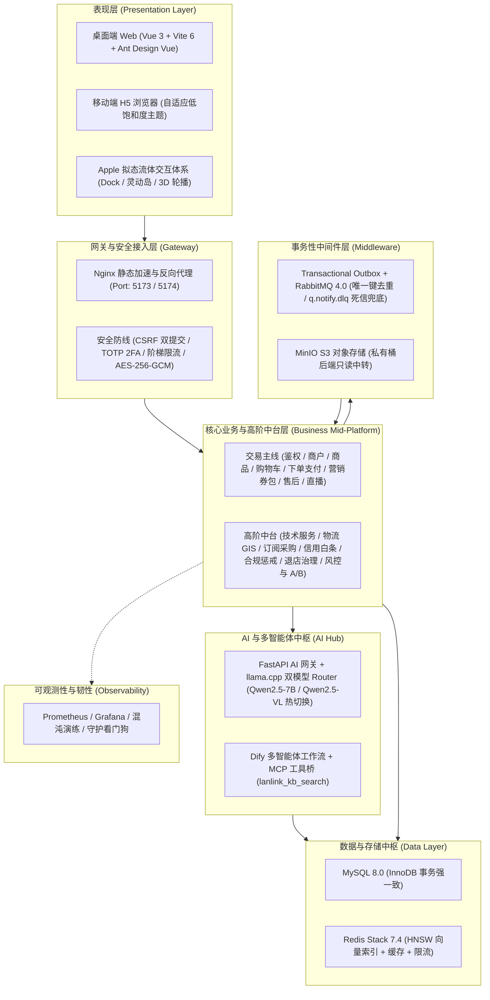

<div align="center">

# LANLinkshopping

### 聚合型一体多元化解决方案 · 现代化工业级 B2B 电商全栈中台平台

**Spring Boot 3.5.3 + Vue 3 (Vite 6) + Redis Stack HNSW + MinIO S3 + RabbitMQ 4.0 + 本地双大模型编排 + Dify 工作流 + Apple UI 交互规范**


[](https://x.com/Orion_Yves_Jude)
[](https://www.facebook.com/profile.php?id=61590596057471)

[功能特性](#-功能特性与业务矩阵) · [系统架构](#-系统架构与技术全景) · [开发文档](#-开发者工程手册与调试指南) · [快速开始](#-快速开始与环境部署) · [核心接口](#-核心接口速览) · [Twitter (X)](https://x.com/Orion_Yves_Jude) · [Facebook](https://www.facebook.com/profile.php?id=61590596057471) · [联系与声明](#-联系方式与原创声明) · [许可证](#-许可证说明)

**[English](./README.en.md)** · 简体中文

</div>

---

## 📖 项目简介与系统定位

**LANLinkshopping** 是一个专为现代化工业供应链、大宗生产资料集采、企业协作与科技成果转化设计的**聚合型、多行业、B2B 一体化全栈电商中台平台**：深度覆盖「统一身份鉴权 · 商户自主入驻与资质审核 · 24 大行业商品商城 · 智能协同推荐 · 购物车 · 下单支付与对账履约」基础交易闭环，并演进出工业品技术服务交易中心、物流 GIS 干线调度、企业订阅采购、企业信用白条、售后多媒体证据链、大促主会场与领券中心、AI 商品标题润色、直播带货、Apple 拟态交互体系、本地双大模型编排（Qwen2.5-7B + Qwen2.5-VL）与 MinIO / RabbitMQ 事务性中间件等工业生产级中台能力。

> [!NOTE]
> 本项目为**教学 / 毕业设计演示项目**，默认运行在本地开发模式，请勿直接用于真实生产资金流交易或未经安全加固对外提供公共服务。

---

## 🏛️ 系统架构与技术全景

### 总体架构拓扑图



### 全技术栈清单速览

| 维度 | 技术选型 | 版本/规范 | 架构作用与定位 |
|------|---------|-----------|----------------|
| **后端主框架** | Spring Boot | 3.5.3 (Java 17 LTS) | 核心微服务与单体应用容器底座，高性能异步通信 |
| | MyBatis-Plus | 3.5.10.1+ | 实体持久化、分页防 SQL 注入与动态条件封装 |
| | Spring Security | 6.x | RBAC 五级鉴权、BCrypt 强密码加盐、TOTP 双因素安全认证 |
| | Spring Cloud | 2025.1.x (演进骨架) | 预研微服务骨架（Nacos 注册中心、Gateway、OpenFeign） |
| **前端体系** | Vue.js | 3.5.x (组合式 API) | 现代化响应式框架，模块化单文件组件 (SFC) |
| | 构建工具 | Vite 6.4.5 | 极速 ESM 开发冷启动、HMR 热更新、Rollup 生产分包优化 |
| | UI 组件库 | Ant Design Vue 4.x | 企业级中后台高质感 UI 交互控件库 |
| | 矢量图标 | Lucide Vue Next | 全站纯矢量 SVG 统一映射治理，无任何 Emoji 字符滥用 |
| | 状态与路由 | Pinia + Vue Router 4.x | 全局响应式状态共享、路由守卫与平滑滚动记忆 |
| **消息与存储** | 对象存储 | MinIO (S3 兼容) + AWS SDK v2 2.57.8 | 商户资质与技术服务材料加密存储；私有桶后端安全代理出站 |
| | 消息队列 | RabbitMQ 4.0 (`rabbitmq:4-management`) | 事务外发模式（Transactional Outbox）、唯一键去重、死信兜底 |
| | 数据库 | MySQL 8.0+ (InnoDB) | 行级排他锁、多表事务 ACID 保证、索引与外键约束优化 |
| | 缓存与向量库 | Redis Stack 7.4 (RediSearch) | 整合 HNSW 向量索引、分布式缓存、分布式限流原子计数 |
| **AI / 大模型** | 推理底座 | llama.cpp (Docker + cuBLAS) | 本地默认适配 Qwen2.5-7B 与 Qwen2.5-VL（受限于 RTX 4070 Laptop 8G 显存；硬件宽裕者可无缝扩展至 14B/32B/72B） |
| | 系统环境 | Ubuntu 22.04 / 24.04 LTS | 原生 Linux 或 Windows WSL2 容器与微调运行环境 |
| | GPU 加速 | CUDA 12.4 / 12.8 / 13.0 | cuBLAS 与 FlashAttention-2 高性能并行计算 |
| | AI 网关 | FastAPI + Uvicorn | 兼容 OpenAI 标准 API、多工具调用 (Tool Calling)、流式输出 |
| | 向量嵌入 | BAAI/bge-m3 | 1024 维多语言高维密集向量嵌入模型 |
| | 多智能体编排 | Dify DSL + MCP | 编排多 Agent 协作工作流；标准 MCP 协议只读向量检索 (`lanlink_kb_search`) |
| | 模型微调强化 | Unsloth + TRL + PyTorch | 工业意图分类 LoRA SFT 微调、AGL/GRPO 强化学习闭环与量化导出 |
| **运维与观测** | 指标与看板 | Prometheus + Grafana | 核心吞吐率 (QPS/TPS)、P99 延迟、GPU 显存占用与显卡温度监控 |
| | 韧性与自愈 | Chaos / Watchdog | 混沌故障断网宕机演练、守护进程健康探活与故障自愈 |

---

## ✨ 核心业务与高阶微中台能力矩阵

### 1. 基础交易全闭环（五大核心模块）

| 模块 | 核心能力 |
|:---|:---|
| 🔐 **登录鉴权中心** | 手机号注册/登录、RBAC 五级权限矩阵（GUEST / BUYER / VIP / MERCHANT / ADMIN）、TOTP 2FA、CSRF 双提交防护与密码错误阶梯锁定。 |
| 🏪 **商户入驻中台** | 企业入驻在线申请与营业执照 MinIO 存证、实缴资本 ≥ 10 万元硬性门槛、智能合规初筛与独立商户管理后台。 |
| 🛍️ **多元商品商城** | 24 大实体行业多级分类索引、阶梯批发价与大宗起订量、多规格 SKU 体系与价格走势日 K 线行情。 |
| 🛒 **智能购物车** | 原子级规格库存校验、大宗批发批量修改数量、一键全选/按店铺勾选结算与运费预估。 |
| 📦 **下单支付履约** | 分布式原子扣减库存、订单全明细快照、支付宝/微信/余额沙箱支付、积分抵扣与白条账期结账，核心入口 [`OrderController.java`](file:///d:/Desktop/LANLinkShopping/Shopping/backend/src/main/java/com/lanlink/shopping/controller/OrderController.java)。 |

### 2. 工业品技术服务与科技成果转化中台

面向工业企业与技术服务商的技术交易与成果转化中台：技术电子合同阶段里程碑验收并绑定第三方资金托管放款、「卡脖子」需求揭榜挂帅公开竞标、专家在线诊断与付费问答、中试基地/共享实验室预约、科技成果 TRL 鉴定评估与设备全生命周期托管维保，模块全景见 [`module/techservice/`](file:///d:/Desktop/LANLinkShopping/Shopping/backend/src/main/java/com/lanlink/shopping/module/techservice)。

### 3. 物流 GIS 轨迹与干线中枢

中国干线物流轨迹与调度中枢：WGS84 / GCJ02 / BD09 高精坐标双向换算引擎（[`coordTransform.js`](file:///d:/Desktop/LANLinkShopping/Shopping/frontend/src/utils/coordTransform.js)）、大圆距离 + 绕行修正因子的干线拓扑路由与在途节点时序推演、运单单节点停留超 24 小时黄灯 / 超 48 小时红灯预警与一键催件改派，以及按服务商账期的对账结算单自动化。

### 4. 营销大促主会场与领券中心

大促主会场集纳各行业爆品、限时满减会场与主推首发专区；高并发领券中心支持阶梯满减、新人专享与限时折扣券一键批量领取，基于 Redis 原子计数防刷（[`AdCampaignController.java`](file:///d:/Desktop/LANLinkShopping/Shopping/backend/src/main/java/com/lanlink/shopping/controller/AdCampaignController.java)）；下单结算实时匹配最优券包组合，订单支付后自动核销。

### 5. 企业周期性订阅采购与任务中心

面向企业高频易耗品（劳保、润滑油脂、传动件等）的周期订阅采购：按周/按月自动生成采购订单草稿、提醒采购专员一键确认付款，避免生产断料；会员任务中心以 `BUYER → VIP` 阶梯成长体系，完成首单、大宗采买与评价互动解锁积分返点与白条提额权益。

### 6. 企业信用白条精准测算器与风控引擎

基于企业注册资本、开票历史、履约评级与采购频次构建多因子评分矩阵，输出最高 500 万元的动态信用额度建议（[`creditCalculator.js`](file:///d:/Desktop/LANLinkShopping/Shopping/frontend/src/utils/creditCalculator.js)）；支持 T+30 / T+60 / T+90 账期免息，逾期按日万分之五阶梯计息，收银台自动拦截未结清逾期账户。

### 7. 售后全流程协商与多媒体证据链存证

仅退款、退货退款、破损补寄与上门返修全轨流转，买家/卖家/平台三方仲裁举证；设备损毁照片、检测报告与维修视频直连 MinIO S3 私有加密桶（[`refundEvidence.js`](file:///d:/Desktop/LANLinkShopping/Shopping/frontend/src/utils/refundEvidence.js)），前端经后端防盗链中转渲染，确保商业举证材料防篡改、安全保密。

### 8. AI 智能商品标题润色与卖点高光

依托本地 Qwen2.5 工业大模型（[`AiTitlePolish.vue`](file:///d:/Desktop/LANLinkShopping/Shopping/frontend/src/components/merchant/AiTitlePolish.vue)），自动提取「品牌 + 核心型号 + 工业规格 + 执行标准 + 适用场景」、过滤夸大极限词，重组为符合 B2B SEO 检索权重的标准化标题，并一键提炼核心卖点高光标签。

### 9. Apple UI 拟态流体交互规范与新一代组件库

秉承 Apple Human Interface Guidelines 的纯矢量拟态交互体系（[`frontend/src/components/ui/`](file:///d:/Desktop/LANLinkShopping/Shopping/frontend/src/components/ui/)）：macOS 物理流体 Dock、iPhone 灵动岛胶囊、带惯性滑块的 FluidAnimatedTabs、跟随光标的 GlowBorderCard 流光边框、RadarPulseBadge 雷达脉冲徽章、SmoothMobileDrawer 触摸抽屉与 3D 景深卡片轮播；图标经 AppleIcon 统一映射 Lucide SVG，杜绝 Emoji 滥用。

### 10. 本地双大模型编排与 MCP 向量中枢

Docker 托管 llama.cpp 双模型 Router：按请求意图热切换 **Qwen2.5-7B（文本）** 与 **Qwen2.5-VL（视觉多模态）**；硬件显存感知调度器（[`hardware_scheduler.py`](file:///d:/Desktop/LANLinkShopping/Shopping/ai-gateway/app/hardware_scheduler.py)）实时感知 GPU 显存与温度，支持全显存加载、CPU 卸载与降级保护；网关侧暴露标准 MCP 只读工具 `lanlink_kb_search`，外部智能体经 `/mcp` 检索共享向量索引 `aikb-idx`。

> [!NOTE]
> **💻 操作系统与硬件适配**：推荐 Ubuntu 22.04 / 24.04 LTS（原生 Linux 或 Windows 11 WSL2）+ CUDA 12.4 / 12.8 / 13.0（NVIDIA 驱动 ≥ 550.x）。作者基准环境为 RTX 4070 Laptop 8G，默认适配并深度支持 Qwen2.5-7B 与 Qwen2.5-VL 双模型；硬件宽裕者（RTX 3090/4090 24G、A100/H100 等）仅需在 `.env` 与 `docker-compose.yml` 调整模型挂载即可升级至 14B/32B/72B 或 FP16/BF16，业务代码零改动。

### 11. 双向合规条款体系与违规惩戒治理中枢 (Legal Compliance & Penalty System)

依托平台法务条款中心（[`LegalCenter.vue`](file:///d:/Desktop/LANLinkShopping/Shopping/frontend/src/views/LegalCenter.vue)）构建买卖双向合规闭环：商户端实缴资本 ≥ 10 万元全链路强校验、正品保真与 48 小时发货履约承诺、年度 12 分动态记分与阶梯惩戒（降权 / 下架 / 提现限制 / 清退关店）；买家端严禁刷单与恶意差评勒索、白条逾期罚息与分级处罚直至供应链失信黑名单；全条款中英双语留痕，入驻与交易全程主动勾选授权。

### 12. 商户退店与闭店全生命周期治理中枢 (Merchant Exit & Closure Governance)

模块全景见 [`module/merchantexit/`](file:///d:/Desktop/LANLinkShopping/Shopping/backend/src/main/java/com/lanlink/shopping/module/merchantexit)。对齐《电子商务法》第十六条法定公示要求，构建「申请 → 运营审核 → 30 天法定公示（可撤回）→ 冻结清算 → 正式关闭」五态不可逆软关闭闭环：六项退店门禁（在途订单 / 进行中售后 / 结算 / 商品下架 / 保证金 / 时间闸门）逐项自查、退店期间商品与报价写操作冻结堵洞、append-only 保证金账面台账（仅账面登记不触发真实打款，严守二清合规口径）与商户/运营双端双语审计轨迹。

### 13. 并发正确性与架构治理（2026-11 加固）

针对「单实例跑通、多实例/高并发出错」问题系统性加固，每项均配可证伪回归测试：广告支付与退款看门狗改条件更新 / CAS 状态机防双扣与部分退款放大、购物车加购 `INSERT ... ON DUPLICATE KEY UPDATE` 原子累加（真机 5 并发 ×100 精确 500）、物流运单落库 CAS 防已签收回退、定时任务 `DbJobLock`（MySQL 命名锁）跨实例互斥；前端 401 同步清理登录态消除踢登循环，nginx upstream 变量化消除下游容器启动顺序依赖。

### 14. 商户资金出金与提现闭环（merchant-finance，2026-11）

模块全景见 [`module/finance/`](file:///d:/Desktop/LANLinkShopping/Shopping/backend/src/main/java/com/lanlink/shopping/module/finance)。提现单全状态机（待审 / 已打款 / 驳回 / 已撤回）全部条件更新防并发抢占；资金路径以商户行排他锁建立当前读次序，append-only 财务台账逐行余额快照，真实双连接并发回归断言恰一成功一拒绝；可提余额 = 已结算净额 − 累计已打款 − 在途冻结，银行账号仅落前 4 后 4 掩码，敏感字段 RSA-2048 + A256GCM JWE 加密落库；打款为线下对公登记，平台不发起出金调用（二清口径）。

### 15. 订单评价闭环（独立订单维度评价模型，2026-11）

独立 `t_order_review` 表按订单商品拆行、唯一键防重复评（重复提交返回业务码 409）；评价落库与商品评分聚合（均分 / 好评率 / 星级分布）同事务提交，公开端点暴露评分摘要（[`OrderReviewService.java`](file:///d:/Desktop/LANLinkShopping/Shopping/backend/src/main/java/com/lanlink/shopping/module/review/service/OrderReviewService.java)）；买家「去评价」与商品详情评价区双端 UI，检索排序链路与评分聚合解耦。

### 16. SEO 基线与按路由 TDK 注入（CSR，2026-11）

`frontend/public/` 提供 robots.txt（私域路由 Disallow）与 sitemap.xml（仅公开路由）并以单测校验路由一致性；34 条公开路由携带 `meta.seo`，经路由钩子注入 title / description / keywords / og，商品详情回写真实商品名、私域路由回落全局兜底；告警经 Alertmanager 邮件 + IM webhook（钉钉/飞书适配器）双通道并行送达，真实地址只存根 `.env` 不进仓库。

### 17. 市场化批次演进总览（对标淘宝/1688/京东，2026-11）

对标主流电商平台的市场化批次演进：埋点 Amplitude 双门控与六事件漏斗、CSRF 拦截扩面与页脚公示区、Flyway 迁移底座（V2026_10 / V2026_11 存量迁移纳管）、nginx gzip 与 assets immutable 缓存、阶梯批发价写侧契约与买家 MOQ 展示、增值税发票需求与地址簿多地址、客服转人工与最小错误上报等 11 个批次，其中评价（第 15 节）、出金（第 14 节）、SEO（第 16 节）已单列成节。

### 18. SQLBot 智能问数集成（LLM + RAG Text-to-SQL，2026-11）

集成 [dataease/SQLBot](https://github.com/dataease/SQLBot) 作为平台智能问数引擎：自然语言直接生成 SQL 并执行（LLM + RAG），容器编排见 [`docker-compose.sqlbot.yml`](file:///d:/Desktop/LANLinkShopping/Shopping/docker-compose.sqlbot.yml)（UI `8000` / 自带 MCP `8001`）；LLM 接线指向本地 AI 网关并关闭网关侧 RAG 模板改写，防止污染 Text-to-SQL 提示词；数据源经专用只读账号 `sqlbot_ro` 同步 6 张核心业务表元数据；网关注册 `lanlink_ask_data` MCP 工具，外部大模型经 `/v1/chat/completions` 即可对话式查询平台业务数据；语义缓存对 sql_gen 类请求关闭写入，连续 10/10 验收达标。

---

## 🛠️ 开发者工程手册与调试指南

### 本地网络拓扑与端口监听矩阵

| 端口 | 服务名称 | 绑定范围 | 核心用途 |
|:---:|:---|:---:|:---|
| **8080** | Spring Boot 后端 | `127.0.0.1` | 业务中台核心 RESTful API（全局 Context-Path `/api`） |
| **5173** | 前端静态加速 / 局域网验收 | `0.0.0.0` | 移动端真机访问 `http://<本机IP>:5173` |
| **5174** | 前端开发调试服务器 | `127.0.0.1` | Vite 热重载，`/api` 代理转发至 8080 |
| **3306** | MySQL 8.0 | `127.0.0.1` | 业务持久化数据库（utf8mb4） |
| **6379** | Redis Stack 7.4 | `127.0.0.1` | HNSW 向量索引 `aikb-idx`、缓存与限流计数 |
| **9000** | MinIO S3 API | `127.0.0.1` | S3 兼容对象存储读写 |
| **9001** | MinIO Web 控制台 | `127.0.0.1` | 存储桶与访问策略管理 |
| **5672** | RabbitMQ AMQP | `127.0.0.1` | 生产者与消费者双向通道 |
| **15672** | RabbitMQ 管理后台 | `127.0.0.1` | 队列堆积、消费速率与死信队列监控 |
| **18123** | llama.cpp 推理底座 | `127.0.0.1` | GGUF 双模型推理（容器内 8123） |
| **1025** | Mailpit SMTP | `127.0.0.1` | 本地测试邮件投递 |
| **8081** | Mailpit Web 邮箱 | `127.0.0.1` | 本地邮件收件箱（验证码拦截） |
| **8000** | SQLBot 智能问数 UI + API | `127.0.0.1` | 对话式数据分析（见能力矩阵第 18 节） |
| **8001** | SQLBot MCP 服务 | `127.0.0.1` | SQLBot 自带 MCP（SSE 传输） |
| **9093** | Alertmanager Web UI | `127.0.0.1` | 告警管理控制台（静默 / 通知状态） |
| **3000** | 批量导入 Workflow | `127.0.0.1` | 大宗商品与采购单批量导入 |

> [!IMPORTANT]
> 除用于局域网多设备真机验收的前端端口绑定所有网卡外，数据库、缓存、对象存储、消息队列与 AI 服务**严格仅绑定 `127.0.0.1` 本地回环地址**，防止局域网端口探测与越权穿透。

### 环境变量与凭据配置（`.env`）

根目录 `.env.example` 提供全部必填项与配置注释（MySQL / Redis / llama.cpp / MinIO / RabbitMQ 五组连接凭据与 `LANLINK_MQ_*_FLOW` 双链路开关），遵循 12-Factor 规范；`docker-compose.yml` 对存储与消息队列凭据启用 `${VAR:?...}` 强约束校验，缺失即报错拦截。切勿将含真实密码的 `.env` 提交至版本管理。

---

## 🚀 快速开始与环境部署

### 前置依赖

JDK 17 LTS、Maven 3.8+（项目自带 `./mvnw`）、Node.js 18+ / 20+ LTS、Docker & Compose v2、MySQL 8.0+、Python 3.10+；推荐 Ubuntu 22.04 / 24.04 LTS 或 Windows 11 WSL2，GPU 需 NVIDIA 驱动 ≥ 550.x + CUDA 12.4 / 12.8 / 13.0（`nvidia-smi` 自检）。

### 本地一键启动（强烈推荐）

Windows 下双击运行根目录 **`启动本地环境.bat`**，或在 PowerShell 终端执行：

```powershell
powershell -ExecutionPolicy Bypass -File start-local-env.ps1
```

脚本自动完成 `.env` 完整性校验、拉起 Redis Stack / MinIO / RabbitMQ / Mailpit / llama.cpp 容器、执行 `schema.sql` 幂等建表、启动后端（8080）与前端（5174 / 5173）并发起全链路健康探针。

### 手动分步启动

```bash
docker compose up -d                                              # 拉起中间件容器
cd backend && mvn spring-boot:run -Dspring-boot.run.profiles=dev  # 后端 8080（dev 幂等建表）
cd frontend && npm install && npm run dev                         # 前端 5174
```

启动成功后浏览器访问 **`http://localhost:5174`**（或 `http://localhost:5173`）；同一局域网移动端可访问 `http://<本机局域网IP>:5173` 体验自适应界面。

---

## 🗂️ 仓库目录全景导览

顶层结构一览（各能力细节以能力矩阵中的代码入口为准）：`backend/`（Spring Boot 3.5.3 后端，`module/` 下含技术服务、营销、退店治理、财务出金、评价、检索等 20+ 高阶中台包）、`frontend/`（Vue 3 + Vite 6，`components/ui/` 为 Apple 拟态组件库）、`ai-gateway/`（FastAPI AI 网关与硬件调度器）、`training/`（Unsloth / TRL 微调与 GGUF 量化导出）、`workflow/`（Dify 多智能体 DSL）、`monitoring/`（Prometheus 规则与 Grafana 看板）、`scripts/`（混沌演练、压测、看门狗）、`docker-compose*.yml`、`start-local-env.ps1` 与 `启动本地环境.bat`。

---

## 🧭 业务使用说明与演示账号

平台内置演示账号矩阵（初始密码统一为 `123456`）：

| 手机号码 | 平台角色 | 演示业务场景 |
|:---:|:---:|:---|
| **`13800000000`** | **平台运营 (ADMIN)** | 商户资质审核终审、物流 GIS 异常调度大屏、全栈指标监控看板、AI 网关调度配置 |
| **`13700000002`** | **商户卖家 (MERCHANT)** | 商户中心工作台、发品与 AI 标题润色、开播推流、出库发货与财务对账 |
| **`13900000001`** | **采购买家 (BUYER)** | 24 行业商城与推荐、直播边播边买、领券结算、白条申请、售后举证 |

---

## 📡 核心 API 接口速览（统一前缀 `/api`）

| 业务领域 | 核心 Endpoint | 业务功能 |
|:---|:---|:---|
| **统一鉴权** | `/auth/login` · `/auth/register` · `/auth/me` | 手机号鉴权、注册与当前身份权限获取 |
| **工业技术服务** | `/tech/contracts` · `/tech/experts` · `/tech/demands` · `/tech/pilot/bookings` | 技术合同与里程碑验收、专家咨询、需求揭榜、中试预约 |
| **物流 GIS 调度** | `/admin/logistics/waybills` · `/exceptions` · `/traces/sync` | 运单跟踪、阻滞异常查询、轨迹批量推进同步 |
| **大促与领券** | `/campaign/list` · `/campaign/coupons/claim` · `/pricing/quote` | 活动清单、批量领券、结算最优优惠试算 |
| **企业信用白条** | `/credit/account/info` · `/credit/apply` · `/credit/bills` | 额度查询、授信测算申请、账单查询 |
| **AI 智能中枢** | `/support/ask` · `/v1/hardware` · `/mcp` | 知识库问答、硬件调度状态、MCP 工具调用 |
| **商品与交易** | `/product/page` · `/cart/add` · `/order/checkout` · `/order/pay/{orderNo}` | 分页检索、购物车、下单结算、沙箱支付 |
| **商户退店治理** | `/merchant/exit/status` · `/merchant/exit/request` · `/admin/merchant-exit/list` · `/admin/merchant-exit/{merId}/close` | 门禁自查、申请退店、审核列表、公示期满关闭 |

---

## 🧪 自动化测试与质量保障体系

当前实测基线（2026-11-15）：

| 套件 | 命令 | 实测结果 |
|:---|:---|:---|
| 后端单元 + 集成测试 | `cd backend && mvn test` | **2046 通过 / 0 失败 / 1 跳过** |
| 前端单元测试 | `cd frontend && npm test` | **630 通过 / 0 失败（71 个测试文件）** |
| 前端生产构建 | `cd frontend && npm run build` | 通过（206 个 JS chunk，5.5 MB raw / 1.87 MB gzip） |

接口延迟实测（本机 Docker，n=10）：`GET /api/product/page` 中位 **25 ms**、`GET /api/product/detail/{id}` 中位 **8 ms**，均低于 200 ms 目标。尚未验证：1000 QPS 并发压测、首屏 LCP < 2s（需压测工具与浏览器自动化，不作达标声明）。

---

## 🔒 全方位安全防护体系

密码 BCrypt 强盐散列 + Google Authenticator TOTP 2FA；统一社会信用代码、银行账号等敏感资产 AES-256-GCM 加密落库；客服与聊天链路实时 PII 脱敏；CSRF 双提交校验、IP / 用户阶梯滑动窗口限流、连续密码错误锁定与实时风控审计；全站商品素材为开源商业友好授权，归档于 [`CREDITS.json`](file:///d:/Desktop/LANLinkShopping/Shopping/frontend/public/products/CREDITS.json)。

---

## 📬 联系方式与原创声明

本项目由 **Jason Ouyang（欧阳）** 独立构思、架构设计与编码开发：GitHub [@c2jxmrywdn-del](https://github.com/c2jxmrywdn-del) · 邮箱 [3514485358@qq.com](mailto:3514485358@qq.com) · X [@Orion_Yves_Jude](https://x.com/Orion_Yves_Jude) · Facebook [Jason Ouyang](https://www.facebook.com/profile.php?id=61590596057471) · WhatsApp [OuyangJason](https://wa.me/OuyangJason?s=t) / 微信 `O19111295446` · 开源主页 [LANLinkshopping-Local-version](https://github.com/c2jxmrywdn-del/LANLinkshopping-Local-version)。

> [!CAUTION]
> **知识产权与维权警告**：本项目（架构设计、功能闭环、UI/UX 视觉体系、前后端与 AI 代码、接口与数据库结构及文档）均为作者拥有独立知识产权的原创毕业设计成果，仅限个人技术学习、学术交流与毕业设计演示用途。未经作者书面授权，严禁任何商业化营利使用（付费课程 / 外包交付 / SaaS 售卖 / 商业包装）、署名篡改、去除版权信息或冒用为独立原创成果（含毕设答辩、竞赛评奖）。作者已对研发历程与提交历史全网公证固证，保留律师函、平台举证下架与依法诉讼等一切维权措施。

---

## 📄 许可证说明

本项目依据 **GNU General Public License v3.0（GPL-3.0）** 授权发布；任何包含本项目源代码的衍生作品必须以相同协议开源（强传染性 Copyleft）。完整协议文本见根目录 [LICENSE](./LICENSE) 文件。

---

<div align="center">

**特别感谢**：[Microsoft Agent-Lightning](https://github.com/microsoft/agent-lightning) · **Qwen 大模型团队** · [21st.dev](https://21st.dev) · [SQLBot（dataease）](https://github.com/dataease/SQLBot)（本平台对话式数据分析能力基于 SQLBot 构建）

Made with ❤️ for Modern B2B E-Commerce & Open Innovation · 2026

</div>
