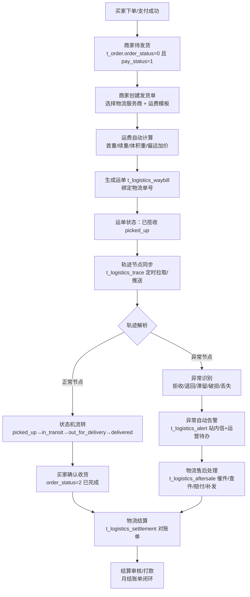
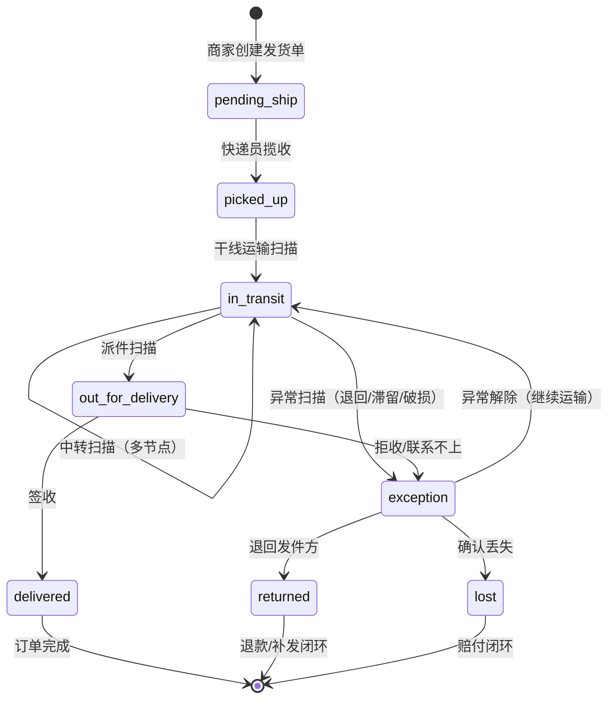
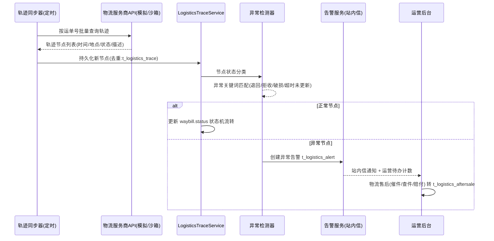
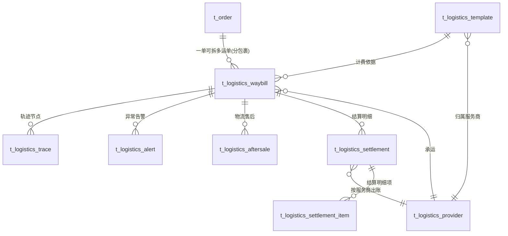

# 物流板块业务设计文档 · 流程图与数据实体关系

> 所属项目：LANLinkshopping B2B 电商平台 ｜ 模块代号：logistics
> 设计参考：1688/京东/亚马逊物流体系（服务商分级管理、运费模板、运单轨迹、异常处理、对账结算）
> 技术栈对齐：Spring Boot 3 + MyBatis-Plus + MySQL 8（t_ 表前缀）+ Vue3 + Ant Design Vue

---

## 一、物流板块业务流程图

### 1.1 全链路业务总览（订单 → 运单 → 轨迹 → 结算）

### 1.2 运单状态机（状态同步核心）

### 1.3 异常物流处理与告警流程

### 1.4 物流结算闭环

---

## 二、数据实体关系设计（ER 图）

### 2.1 实体关系总图

### 2.2 实体明细设计

#### t_logistics_provider 物流服务商（需求 2：服务商管理）

| 字段 | 类型 | 说明 |
|------|------|------|
| provider_id | BIGINT PK AI | 服务商 ID |
| provider_name | VARCHAR(64) | 服务商名称（顺丰/德邦/京东物流/中通/自送） |
| provider_code | VARCHAR(32) UNIQUE | 编码（SF/DB/JD/ZT/SELF），接口对接标识 |
| contact_name / contact_phone | VARCHAR | 对接人联系方式 |
| api_type | VARCHAR(16) | 接口类型：mock=沙箱模拟 / api=真实接口 / manual=手工录入 |
| api_endpoint | VARCHAR(255) | 轨迹查询接口地址（本地/沙箱） |
| api_key | VARCHAR(255) | 接口密钥（加密存储，可空） |
| capability_json | VARCHAR(500) | 能力标记 JSON：{cod:货到付款,insure:保价,signBack:签单返还} |
| status | TINYINT | 0 停用 / 1 启用 |
| settle_cycle | VARCHAR(16) | 结算周期：monthly / weekly / realtime |
| sort / create_time / update_time / deleted | — | 常规审计字段 |

#### t_logistics_template 运费模板（需求 2：模板配置）

| 字段 | 类型 | 说明 |
|------|------|------|
| template_id | BIGINT PK AI | 模板 ID |
| template_name | VARCHAR(64) | 模板名称（如"华东仓顺丰标快"） |
| provider_id | BIGINT FK | 归属物流服务商 |
| pricing_type | VARCHAR(16) | 计费方式：weight=按重量 / volume=按体积 / fixed=固定运费 / piece=按件 |
| first_weight | DECIMAL(10,2) | 首重（kg/件） |
| first_price | DECIMAL(10,2) | 首重费用（元） |
| continued_weight | DECIMAL(10,2) | 续重单位 |
| continued_price | DECIMAL(10,2) | 续重费用（元/单位） |
| volume_factor | DECIMAL(10,2) | 体积重系数（默认 1:6000，长*宽*高/6000） |
| free_threshold | DECIMAL(12,2) | 满额包邮门槛（0=不启用） |
| region_rule_json | TEXT | 区域加价规则 JSON：[{regions:["新疆","西藏"], firstPrice:20, continuedPrice:10}] |
| remote_surcharge | DECIMAL(10,2) | 偏远地区附加费 |
| status | TINYINT | 0 停用 / 1 启用 |
| /create_time/update_time/deleted | — | 常规字段 |

#### t_logistics_waybill 运单/物流订单（需求 4：订单管理+发货）

| 字段 | 类型 | 说明 |
|------|------|------|
| waybill_id | BIGINT PK AI | 运单 ID |
| waybill_no | VARCHAR(32) UNIQUE | 平台运单号（LL+日期+序列，如 LL202610150001） |
| order_no | VARCHAR(32) | 关联订单号（t_order.order_no，索引） |
| order_item_ids | VARCHAR(255) | 分包裹时关联的订单明细 ID（逗号分隔） |
| provider_id | BIGint FK | 物流服务商 |
| template_id | BIGINT FK | 运费模板 |
| logistics_no | VARCHAR(64) | 第三方物流单号（快递单号，唯一索引） |
| freight | DECIMAL(10,2) | 实际运费（元） |
| freight_calc_json | VARCHAR(500) | 计费快照（首重/续重/区域加价明细，留痕） |
| weight / volume | DECIMAL(10,3) | 计费重量(kg)/体积(m³) |
| sender_name/phone/address | VARCHAR | 寄件人信息 |
| receiver_name/phone/province/city/district/address | VARCHAR | 收件信息 |
| status | VARCHAR(24) | 状态机：pending_ship/picked_up/in_transit/out_for_delivery/delivered/exception/returned/lost/cancelled |
| exception_flag | TINYINT | 0 正常 / 1 有活跃异常告警 |
| ship_time / delivered_time | DATETIME | 发货/签收时间 |
| created_by | BIGINT | 操作人（商家/运营） |
| create_time/update_time/deleted | — | 常规字段 |

> 索引设计：`uk_waybill_no` / `uk_logistics_no` 唯一约束；`idx_waybill_order(order_no)`、`idx_waybill_status(status)`、`idx_waybill_provider(provider_id)` 常规查询；**联合索引 `idx_waybill_provider_ship(provider_id, ship_time)`** 服务于结算生成的 `provider_id 等值 + ship_time 区间` 查询（`LogisticsSettlementService.generate()`），避免服务商维度下按时间逐行扫描。

#### t_logistics_trace 轨迹节点（需求 3：轨迹同步）

| 字段 | 类型 | 说明 |
|------|------|------|
| trace_id | BIGINT PK AI | 轨迹 ID |
| waybill_id | BIGINT FK | 运单 |
| trace_time | DATETIME | 节点时间 |
| location | VARCHAR(128) | 节点地点 |
| status | VARCHAR(24) | 节点状态（与运单状态映射） |
| description | VARCHAR(255) | 轨迹描述原文 |
| is_abnormal | TINYINT | 0 正常 / 1 异常节点 |
| source | VARCHAR(16) | 来源：api=接口同步 / manual=人工录入 |
| create_time | DATETIME | 入库时间 |

#### t_logistics_alert 异常告警（需求 3：自动告警）

| 字段 | 类型 | 说明 |
|------|------|------|
| alert_id | BIGINT PK AI | 告警 ID |
| waybill_id | BIGINT FK | 运单 |
| alert_type | VARCHAR(24) | 类型：delay=超时滞留 / reject=拒收 / return=退回 / damage=破损 / lost=丢失 / timeout_no_update=轨迹停更 |
| alert_level | VARCHAR(12) | low / medium / high |
| content | VARCHAR(255) | 告警内容 |
| status | VARCHAR(12) | pending 待处理 / processing 处理中 / resolved 已解决 |
| handled_by / handled_at / handle_note | — | 处理留痕 |
| create_time | DATETIME | 告警时间 |

#### t_logistics_aftersale 物流售后（需求 4：售后处理）

| 字段 | 类型 | 说明 |
|------|------|------|
| aftersale_id | BIGINT PK AI | 售后单 ID |
| aftersale_no | VARCHAR(32) UNIQUE | 售后单号 |
| waybill_id / order_no | — | 关联运单/订单 |
| aftersale_type | VARCHAR(16) | expedite=催件 / trace=查件 / claim=赔付 / reship=补发 / return_freight=退回运费 |
| description | VARCHAR(500) | 诉求描述 |
| evidence_json | VARCHAR(500) | 凭证（图片 URL 列表） |
| claim_amount | DECIMAL(10,2) | 赔付金额（claim 类型） |
| status | VARCHAR(16) | pending/processing/approved/rejected/done |
| processor_id / process_note / process_time | — | 处理留痕 |
| create_time/update_time/deleted | — | 常规字段 |

#### t_logistics_settlement / _item 物流结算（需求：结算闭环）

| 字段（主表） | 类型 | 说明 |
|------|------|------|
| settlement_id | BIGINT PK AI | 结算单 ID |
| settlement_no | VARCHAR(32) UNIQUE | 结算单号（JS+年月+序列） |
| provider_id | BIGINT FK | 物流服务商 |
| period_start / period_end | DATE | 账期 |
| waybill_count | INT | 运单数 |
| total_freight | DECIMAL(12,2) | 运费合计 |
| deduction / extra_fee | DECIMAL(12,2) | 扣减/附加（赔付冲抵） |
| payable_amount | DECIMAL(12,2) | 应付金额 |
| status | VARCHAR(16) | draft/pending_review/approved/paid |
| reviewer_id / review_note / paid_time | — | 审核打款留痕 |
| create_time/update_time/deleted | — | 常规字段 |

| 字段（明细表 _item） | 类型 | 说明 |
|------|------|------|
| item_id | BIGINT PK AI | 明细 ID |
| settlement_id | BIGINT FK | 结算单 |
| waybill_id / waybill_no | — | 运单 |
| freight | DECIMAL(10,2) | 该单运费 |
| remark | VARCHAR(255) | 备注（差异说明） |

### 2.3 与现有订单模型的衔接

- **t_order 不加列**（历史库兼容、字段稳定）：物流信息全部落 t_logistics_waybill，以 `order_no` 关联，符合"分包裹"（一单多运单）主流设计；
- 发货动作由 `LogisticsOrderService.ship()` 事务完成：校验订单状态 → 建运单 → 订单状态流转（order_status=1 待收货）→ 写轨迹首节点 → 审计日志；
- 签收动作回写订单（order_status=2），由轨迹同步器 delivered 节点或买家确认触发。

---

## 三、核心业务规则（供实现与测试对齐）

1. **运费计算公式**（weight 计费）：
   `freight = first_price + max(0, ceil((chargeable_weight - first_weight) / continued_weight)) * continued_price + remote_surcharge + region_surcharge`
   其中 `chargeable_weight = max(实际重量, 体积重量)`，体积重量 = 长×宽×高(cm)/volume_factor；
   `order_amount ≥ free_threshold`（>0 时）→ freight = 0；
   计费结果与明细快照必须落 `freight_calc_json` 保证可审计。
2. **状态机约束**：状态只能沿 1.2 图的合法边流转，禁止跳级/回退（如 delivered 不可回到 in_transit）；非法流转抛 BusinessException。
3. **轨迹去重**：`UNIQUE(waybill_id, trace_time, status, description)` 防重复同步。
4. **异常告警幂等**：同一运单同类型未处理告警存在时，不重复创建。
5. **结算幂等**：同一服务商同账期只允许存在一张非作废结算单（生成时校验）。

---

## 四、模块集成点（与现有系统无缝对接）

| 现有模块 | 集成方式 |
|----------|----------|
| t_order 订单 | 发货/签收状态回写（事务）；订单详情页展示运单卡片 |
| AuthInterceptor + @RequirePerm | 商家发货 `logistics:ship`、运营管理 `admin:all`、买家查件放行（本人运单） |
| AuditService | 发货/审核/结算关键操作记录审计 |
| 消息中心 t_message | 异常告警站内信推送 |
| MessageService | 对应告警消息模板 |
| 前端 MainLayout/管理端 | 商家侧"物流管理"菜单 + 运营侧"物流中心"后台 |
